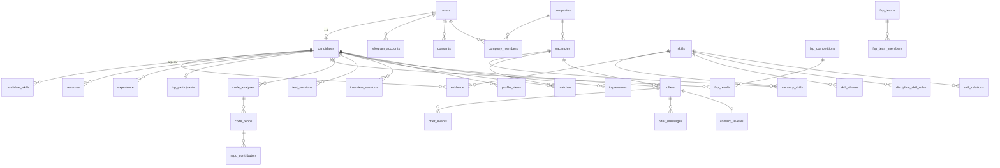

# Модель данных

> ⚠️ Таблицы модуля `assessment` v2 (`surveys`, `families`, `attempts`, `responses`, `grades`) — [assessment.md §3](assessment.md#3-данные).

> PostgreSQL 16. Расширения: `pgvector`, `pg_trgm`, `citext`, `pgcrypto`.
> ID — UUID v7 (генерируются в приложении, сортируются по времени). Время — `timestamptz`. Деньги — целые рубли в месяц «на руки» (`int`).
> DDL ниже — **ориентир для моделей SQLAlchemy и миграций Alembic**, а не финальный скрипт. Владелец таблиц — `core` (база `core`), кроме §3.10 — база `fsp_connector`.
> Как эти таблицы складываются в граф (вершины, рёбра, проекции) — [graph.md](graph.md). Рост графа навыков — [skills.md](skills.md).

## 1. Перечисления (общие для бэка, фронта и ML: `packages/contracts/enums.py`)

| Перечисление | Значения |
|---|---|
| `user_role` | `candidate`, `employer`, `fsp_admin` (роль внутри компании хранится в `company_members.role`: `admin` — владелец, `member` — HR, E39-24) |
| `grade` | `intern`, `junior`, `junior_plus`, `middle`, `middle_plus`, `senior`, `lead` (порядок 0…6) |
| `role_slug` | `backend`, `frontend`, `fullstack`, `mobile`, `ml`, `data_engineer`, `devops`, `qa`, `security`, `gamedev`, `embedded`, `analyst`, `product`, `designer` |
| `work_format` | `office`, `hybrid`, `remote` |
| `employment_type` | `full`, `part`, `internship`, `project` |
| `search_status` | `active` (активно ищу, 7 дней), `open` (открыт к предложениям), `dnd` (не беспокоить) |
| `evidence_source` | `self`, `resume`, `github`, `test`, `ai_interview`, `fsp`, `codeforces` |
| `skill_kind` | `hard`, `soft`, `domain` |
| `skill_status` | `provisional`, `active`, `merged`, `rejected` |
| `relation_kind` | `adjacent`, `parent` |
| `relation_source` | `seed`, `judge`, `cooccurrence`, `admin` |
| `team_signal` | `leadership`, `teamwork`, `results`, `growth` |
| `trust_level` | 0…4 (○○○○ … ●●●●) |
| `offer_status` | `sent`, `viewed`, `accepted`, `declined`, `expired`, `withdrawn`, `interview`, `hired`, `not_hired` |
| `decline_reason` | `low_salary`, `wrong_stack`, `wrong_format`, `wrong_grade`, `not_looking`, `other` |
| `consent_type` | `pd_processing` (обязательное), `fsp_data`, `code_analysis`, `telegram_notifications`, `public_profile`, `profile_publication` |
| `fsp_discipline` | `algorithmic`, `product`, `security`, `uav`, `robotics` ⚠️ |
| `fsp_level` | `regional`, `interregional`, `national`, `international` ⚠️ |
| `fsp_rank` | `youth_3`, `youth_2`, `youth_1`, `rank_3`, `rank_2`, `rank_1`, `cms` (КМС), `ms` (МС), `msic` (МСМК) ⚠️ |
| `job_status` | `queued`, `running`, `done`, `failed` |
| `company_status` | `pending`, `verified`, `rejected`, `blocked` |

## 2. ER-диаграмма (основное)



## 3. DDL по контекстам

### 3.1. Идентификация и согласия

```sql
CREATE TABLE users (
  id            uuid PRIMARY KEY,
  email         citext UNIQUE,                  -- NULL для пользователей только из Telegram
  password_hash text,                           -- argon2id
  role          text NOT NULL,                  -- user_role
  is_active     boolean NOT NULL DEFAULT true,
  created_at    timestamptz NOT NULL DEFAULT now(),
  deleted_at    timestamptz,
  email_verified_at timestamptz,                  -- v2, миграция s0_02 (blocks.md §4.6)
  is_demo       boolean NOT NULL DEFAULT false    -- E40-1 (b2_17): демо-аккаунт `*@demo.fsp.test` (seed, жюри)
);
-- E40-1: is_demo есть у users, companies, vacancies, offers (частичный индекс WHERE is_demo).
-- Компания — демо, если создана демо-пользователем; вакансия — если компания демо; приглашение —
-- если демо компания или кандидат. Демо не идёт в цифры лендинга, дашборд ФСП и метрики;
-- `make demo-reset` сбрасывает только его (evaluation.md §4).

CREATE TABLE telegram_accounts (
  user_id     uuid PRIMARY KEY REFERENCES users(id) ON DELETE CASCADE,
  tg_user_id  bigint UNIQUE NOT NULL,
  chat_id     bigint NOT NULL,
  username    text,
  linked_at   timestamptz NOT NULL DEFAULT now()
);

CREATE TABLE refresh_tokens (
  id          uuid PRIMARY KEY,
  user_id     uuid NOT NULL REFERENCES users(id) ON DELETE CASCADE,
  token_hash  text NOT NULL UNIQUE,            -- sha256
  family_id   uuid NOT NULL,                   -- ротация: повторное использование → отзыв всей семьи
  expires_at  timestamptz NOT NULL,
  revoked_at  timestamptz,
  user_agent  text
);

CREATE TABLE consents (
  user_id     uuid REFERENCES users(id) ON DELETE CASCADE,
  type        text NOT NULL,                   -- consent_type
  version     text NOT NULL,                   -- версия текста согласия
  granted_at  timestamptz NOT NULL,
  revoked_at  timestamptz,
  PRIMARY KEY (user_id, type, granted_at)
);
```

### 3.2. Кандидат

```sql
CREATE TABLE candidates (
  user_id            uuid PRIMARY KEY REFERENCES users(id) ON DELETE CASCADE,
  pseudonym          text NOT NULL UNIQUE,            -- «Backend #4821», стабилен (пока «Candidate #4821»: роль при создании неизвестна)
  pseudo_id          text NOT NULL UNIQUE,            -- HMAC(PSEUDO_ID_SECRET, user_id)[:12], ключ для работодателя
  public_slug        text UNIQUE,                     -- для публичного профиля и бейджа (по желанию)
  full_name_enc      bytea,                           -- ПДн шифруются Fernet
  contacts_enc       bytea,                           -- {email, phone, telegram}
  full_name_enc      bytea,                           -- ФИО, Fernet; работодателю после приглашения от его компании или при visibility.full_name (E36-5, E39-15)
  avatar_key         text,                            -- аватар в MinIO: candidate-avatars/{user_id}/{sha256[:16]}.{png|jpg|webp}; работодателю после приглашения (E41-12)
  links_enc          bytea,                           -- ссылки кандидата (JSON-список), Fernet; только владельцу (E39-15, миграция b1_16)
  hidden_skills      text[],                          -- slug навыков, скрытых от работодателя; подбор не меняют (E39-15, b1_16)
  age_group          text,                            -- adult | minor (15–17 лет), E32-5b; дата рождения не хранится
  parent_consent_at  timestamptz,                     -- согласие родителя на ПДн несовершеннолетнего; без него minor не публикуется
  desired_roles      text[],                          -- желаемые роли из ручной формы (E20-4): slug профессий системы (E41-6)
  city               text,
  relocation         boolean DEFAULT false,
  search_status      text NOT NULL DEFAULT 'open',    -- search_status
  active_until       timestamptz,                     -- для «активно ищу 7 дней»
  salary_min         int,                             -- ₽/мес на руки
  formats            text[] NOT NULL DEFAULT '{}',    -- work_format[]
  employment_types   text[] NOT NULL DEFAULT '{}',
  visibility         jsonb NOT NULL DEFAULT '{"full_name":false,"companies":true,"fsp":true,"region":true,"education":false,"repos":false,"teams":true,"public_profile":false}',
  stoplist_company_ids uuid[] NOT NULL DEFAULT '{}',
  -- вычисляемое движком доверия (F5):
  profile_version    int NOT NULL DEFAULT 0,
  grade              text,                            -- grade
  grade_score        real,
  grade_confidence   real,                            -- 0..1, < 0.5 → «предварительно»
  grade_breakdown    jsonb,                           -- [{signal, value, points, evidence_ids}]
  grade_next         jsonb,                           -- {grade, points_needed, hints[{signal, max_gain, text}]} (ml.md §5)
  primary_role       text,
  roles              jsonb,                           -- [{role, weight}]
  primary_stack      text[],                          -- slug навыков
  team_signals       jsonb,                           -- {"leadership": {"value":0.47, "facts":[…]}, …} (skills.md §8)
  claimed_soft       text[],                          -- софт-навыки «указано в резюме», в расчётах не участвуют
  has_fsp            boolean NOT NULL DEFAULT false,
  verified_skills_cnt int NOT NULL DEFAULT 0,         -- навыков с уровнем ≥ 3
  profile_text       text,                            -- текст для эмбеддинга (из графа, без ПДн; E4-5)
  profile_text_sha   text,                            -- sha256 текста, по которому посчитан embedding
  embedding_model    text,
  embedding          vector(1024),
  experience_months  int,
  recompute_requested_at timestamptz,               -- слияние пересчётов (graph.md §4.4)
  recomputed_at      timestamptz,
  updated_at         timestamptz NOT NULL DEFAULT now(),
  deleted_at         timestamptz
);
CREATE INDEX ON candidates USING hnsw (embedding vector_cosine_ops);
CREATE INDEX ON candidates (primary_role, grade) WHERE deleted_at IS NULL AND search_status <> 'dnd';

CREATE TABLE experience (
  id           uuid PRIMARY KEY,
  candidate_id uuid NOT NULL REFERENCES candidates(user_id) ON DELETE CASCADE,
  company      text,                 -- скрыто от работодателя, пока visibility.companies = false
  title        text,
  start_date   date, end_date date,  -- NULL = по настоящее время
  description  text,
  skill_ids    uuid[],
  is_commercial boolean DEFAULT true,
  source       text NOT NULL         -- resume | self
);

CREATE TABLE education (
  id uuid PRIMARY KEY, candidate_id uuid REFERENCES candidates(user_id) ON DELETE CASCADE,
  institution text, degree text, field text, year_end int
);

CREATE TABLE resumes (
  id             uuid PRIMARY KEY,
  candidate_id   uuid NOT NULL REFERENCES candidates(user_id) ON DELETE CASCADE,
  file_key       text NOT NULL,
  sha256         text NOT NULL,
  mime           text NOT NULL,
  status         text NOT NULL,      -- queued | parsing | parsed | confirmed | failed
  parser_version text,
  parsed         jsonb,              -- ParsedResume (contracts)
  error          text,
  created_at     timestamptz NOT NULL DEFAULT now(),
  confirmed_at   timestamptz
);

CREATE TABLE category_disputes (
  id uuid PRIMARY KEY, candidate_id uuid REFERENCES candidates(user_id) ON DELETE CASCADE,
  claimed_role text, claimed_grade text, comment text,
  created_at timestamptz DEFAULT now(), resolved_at timestamptz
);

-- v2 (миграция s0_01; blocks.md §4.2): текущий грейд по профессии; пишет блок 1, читает блок 2
CREATE TABLE grades (
  candidate_id uuid REFERENCES candidates(user_id) ON DELETE CASCADE,
  profession text, grade text NOT NULL, theta float NOT NULL, se float,
  band_position float NOT NULL, theta_by_type jsonb NOT NULL DEFAULT '{}',
  integrity float NOT NULL DEFAULT 1.0,
  needs_confirmation boolean NOT NULL DEFAULT false, low_confidence boolean NOT NULL DEFAULT false,
  source text NOT NULL,                  -- test | seed
  attempt_id uuid,                       -- FK на attempts добавит блок 1
  confirmed_at timestamptz NOT NULL, valid_until timestamptz NOT NULL, next_change_at timestamptz NOT NULL,
  updated_at timestamptz NOT NULL DEFAULT now(),
  PRIMARY KEY (candidate_id, profession)
);
-- миграция b1_03 (E22-1): grades.attempt_id REFERENCES attempts(id) ON DELETE SET NULL
-- миграция b1_13 (E32-4a): grades.mode, attempts.mode text NOT NULL DEFAULT 'standard' -- standard | express

-- v2 (миграция b1_03; assessment.md §3): опрос, банк семейств, попытки, ответы
CREATE TABLE surveys (
  id uuid PRIMARY KEY, candidate_id uuid NOT NULL REFERENCES candidates(user_id) ON DELETE CASCADE,
  industry text, profession text NOT NULL, stack jsonb NOT NULL DEFAULT '[]', formats jsonb NOT NULL DEFAULT '[]',
  salary_from int, salary_to int, declared_grade text, created_at timestamptz NOT NULL DEFAULT now()
);                                       -- история — новые строки
CREATE TABLE families (
  id uuid PRIMARY KEY,                   -- у кодовых семейств uuid5 от slug
  slug text UNIQUE NOT NULL, kind text NOT NULL,
  source text NOT NULL,                  -- code | spec | mutation | llm | fsp
  skill_id uuid NOT NULL,                -- taxonomy.service.skill_id(slug), без FK
  skill_type text NOT NULL, level smallint NOT NULL, b float NOT NULL, n int NOT NULL DEFAULT 0,
  anchor boolean NOT NULL DEFAULT false,
  status text NOT NULL DEFAULT 'draft',  -- draft | pilot | active | quarantine | retired
  spec jsonb, key_status text NOT NULL DEFAULT 'approved', author_id uuid, company_id uuid,
  competition_id text,                   -- source = fsp: соревнование ФСП (E32-6), индекс
  ai_solvable float NOT NULL DEFAULT 0, stats jsonb NOT NULL DEFAULT '{}', version int NOT NULL DEFAULT 1,
  created_at timestamptz NOT NULL DEFAULT now(), updated_at timestamptz NOT NULL DEFAULT now()
);
CREATE TABLE attempts (
  id uuid PRIMARY KEY, candidate_id uuid NOT NULL REFERENCES candidates(user_id) ON DELETE CASCADE,
  profession text NOT NULL, declared_grade text NOT NULL,
  stage text NOT NULL DEFAULT 'main',    -- main | bonus
  status text NOT NULL DEFAULT 'active', -- active | passed | failed | abandoned
  plan jsonb NOT NULL DEFAULT '{}',      -- {domain, order: [family_id], target}
  theta float, se float, llr float NOT NULL DEFAULT 0, integrity float NOT NULL DEFAULT 1.0,
  started_at timestamptz NOT NULL DEFAULT now(), finished_at timestamptz
);
CREATE TABLE responses (                 -- ключа нет: задание пересобирается из (family_id, seed)
  id uuid PRIMARY KEY, attempt_id uuid NOT NULL REFERENCES attempts(id) ON DELETE CASCADE,
  seq int NOT NULL, family_id uuid NOT NULL REFERENCES families(id),
  seed bigint NOT NULL,                  -- sha256(candidate_id:attempt_id:family_id), 63 бита
  is_pilot boolean NOT NULL DEFAULT false, answer jsonb, score float, rt_ms int, telemetry jsonb,
  created_at timestamptz NOT NULL DEFAULT now(), answered_at timestamptz,  -- null — выдано, не отвечено
  UNIQUE (attempt_id, seq), UNIQUE (attempt_id, family_id)
);
```

### 3.3. Доказательства и навыки (движок доверия)

```sql
CREATE TABLE evidence (
  id            uuid PRIMARY KEY,
  candidate_id  uuid NOT NULL REFERENCES candidates(user_id) ON DELETE CASCADE,
  skill_id      uuid NOT NULL REFERENCES skills(id),
  source        text NOT NULL,         -- evidence_source
  strength      real NOT NULL CHECK (strength BETWEEN 0 AND 1),
  observed_at   date NOT NULL,         -- дата факта (соревнования, последнего коммита, теста)
  fact_type     text NOT NULL,         -- fsp_result | code_repo | test_session | interview_session | resume | experience
  fact_id       uuid NOT NULL,         -- вершина-факт, из которой идёт ребро «подтверждает»
  details       jsonb,                 -- человекочитаемое: {"title":"Призёр Кубка России…","place":2,"of":120}
  verified      boolean NOT NULL DEFAULT true,  -- false для ФСП без верификации
  is_active     boolean NOT NULL DEFAULT true,
  created_at    timestamptz NOT NULL DEFAULT now(),
  UNIQUE (candidate_id, skill_id, source, fact_type, fact_id)   -- идемпотентный upsert
);
CREATE INDEX ON evidence (candidate_id) WHERE is_active;
CREATE INDEX ON evidence (skill_id);
CREATE INDEX ON evidence (fact_type, fact_id);

CREATE TABLE candidate_skills (            -- агрегат, пересобирается в F5
  candidate_id  uuid REFERENCES candidates(user_id) ON DELETE CASCADE,
  skill_id      uuid REFERENCES skills(id),
  confidence    real NOT NULL,            -- 0..1
  level         smallint NOT NULL,        -- trust_level 0..4
  sources       text[] NOT NULL,          -- типы источников
  top_evidence  text[] NOT NULL,          -- id до 3 сильнейших доказательств (строками) для объяснений
  claimed_only  boolean NOT NULL,         -- только self/resume
  derived       boolean NOT NULL DEFAULT false,  -- выведено по иерархии (graph.md §5.1)
  derived_from  uuid,                     -- дочерний навык-источник
  updated_at    timestamptz NOT NULL DEFAULT now(),
  PRIMARY KEY (candidate_id, skill_id)
);
CREATE INDEX ON candidate_skills (skill_id, level);
```

### 3.4. Справочник (таксономия)

```sql
CREATE TABLE skills (
  id                 uuid PRIMARY KEY,
  slug               text UNIQUE NOT NULL,       -- python, fastapi, postgresql, algorithms
  name               text NOT NULL,              -- «PostgreSQL»
  kind               text NOT NULL,              -- skill_kind: hard | soft | domain
  grp                text,                       -- language | backend | frontend | mobile | data_ml | storage | devops | security | embedded | fundamentals
  status             text NOT NULL DEFAULT 'active',  -- skill_status
  source             text NOT NULL,              -- seed | pipeline | admin
  merged_into        uuid REFERENCES skills(id),
  support_candidates int NOT NULL DEFAULT 0,     -- у скольких разных кандидатов встречается
  support_vacancies  int NOT NULL DEFAULT 0,
  testable           boolean NOT NULL DEFAULT false,   -- есть банк вопросов
  description        text,                       -- короткое описание для эмбеддинга и судьи
  embedding          vector(1024),
  created_at         timestamptz NOT NULL DEFAULT now()
);
CREATE INDEX ON skills USING hnsw (embedding vector_cosine_ops);
CREATE TABLE skill_aliases (
  alias_norm text PRIMARY KEY,                  -- «постгрес», «pg», «postgres», «коммуникабельный»
  skill_id   uuid NOT NULL REFERENCES skills(id),
  source     text NOT NULL,                     -- seed | fuzzy | judge | admin
  confidence real
);
CREATE TABLE skill_relations (                  -- рёбра графа навыков
  skill_a    uuid REFERENCES skills(id),
  skill_b    uuid REFERENCES skills(id),
  kind       text NOT NULL,                     -- adjacent (хранится в обе стороны) | parent (a — дочерний, b — родитель)
  weight     real NOT NULL CHECK (weight BETWEEN 0 AND 1),
  source     text NOT NULL,                     -- relation_source
  confidence real,
  updated_at timestamptz DEFAULT now(),
  PRIMARY KEY (skill_a, skill_b, kind)
);
CREATE INDEX ON skill_relations (skill_b, kind);
CREATE TABLE skill_distinct (skill_a uuid, skill_b uuid, PRIMARY KEY (skill_a, skill_b));   -- «точно разные»: Java ≠ JavaScript
CREATE TABLE skill_blocklist (norm text PRIMARY KEY, reason text, created_at timestamptz DEFAULT now());  -- мат, ПДн, мусор
CREATE TABLE skill_mentions (                   -- журнал и кеш решений конвейера
  id          bigserial PRIMARY KEY,
  raw         text NOT NULL, norm text NOT NULL,
  context     text,                             -- resume | vacancy | repo | query
  decision    text NOT NULL,                    -- alias | fuzzy | new | same_pending | rejected
  skill_id    uuid, relation text, scores jsonb, model_version text,
  created_at  timestamptz DEFAULT now()
);
CREATE INDEX ON skill_mentions (norm);
CREATE TABLE skill_merges (id uuid PRIMARY KEY, from_skill uuid, into_skill uuid, actor text, moved jsonb, created_at timestamptz DEFAULT now(), reverted_at timestamptz);
CREATE TABLE roles (slug text PRIMARY KEY, name text NOT NULL, is_profession boolean NOT NULL DEFAULT false, is_active boolean NOT NULL DEFAULT true);  -- профессия теста (E21-1, миграция b1_01); is_active = false — скрыта в опросе, данные остаются (ADR-027 п.1, E36-2, миграция b2_13); skills.skill_type text: fundamental|hard|thinking|business|soft|experience
CREATE TABLE role_skills (role text REFERENCES roles(slug), skill_id uuid REFERENCES skills(id), weight real, source text NOT NULL DEFAULT 'seed', PRIMARY KEY (role, skill_id));
CREATE TABLE disciplines (slug text PRIMARY KEY, name text NOT NULL);
CREATE TABLE discipline_skill_rules (
  id         uuid PRIMARY KEY,
  discipline text NOT NULL REFERENCES disciplines(slug),
  skill_id   uuid NOT NULL REFERENCES skills(id),
  weight     real NOT NULL,              -- 0..1
  track      text                        -- NULL = для всей дисциплины; иначе для конкретного трека (D из 9.4)
);
CREATE UNIQUE INDEX ON discipline_skill_rules (discipline, skill_id, coalesce(track, ''));
CREATE TABLE scoring_config (key text PRIMARY KEY, value jsonb NOT NULL, version int NOT NULL, updated_at timestamptz);
```

Ядро графа навыков на старте — YAML в `data/taxonomy/*.yaml` (ревью в git), собирается из тегов Stack Overflow, карты пакетов и русских названий. `make taxonomy-load` загружает его в БД. Дальше граф растёт через конвейер ([skills.md](skills.md)), правки идут через админку, есть экспорт в YAML.

Формат YAML (читает `services/core/app/taxonomy/loader.py`; ключи верхнего уровня всех `data/taxonomy/*.yaml` сливаются, незнакомые файлы, например `package_map.yaml`, игнорируются): `skills` (`slug, name, kind, group?, testable?, description?, aliases?`), `adjacent` (`a, b, weight`), `parent` (`child, parent, weight`), `distinct` (пары), `blocklist` (`norm, reason?`), `roles` (`slug, name, profession?, skills: {slug: вес}`), `skill_types` (`type, skills[]` — переопределения типа навыка; по умолчанию из `kind`/`group`, E21-1). Slug роли — `ProfessionSlug`; профессия (`profession: true`) обязана покрывать все 6 типов навыков. Правила дисциплин берутся из `data/fsp/discipline_rules.yaml` (навык, которого нет в ядре, пропускается с предупреждением). Загрузка идемпотентна: id вершин ядра — `uuid5(slug)`, правятся только строки с `source=seed` (то, что сделали админ или конвейер, остаётся), `adjacent` пишется в обе стороны, `skill_distinct` — одна строка на пару (`skill_a < skill_b`). Версия справочника — `scoring_config` ключ `taxonomy` (`version` + хеш снимка в `value`); при изменении содержимого версия растёт и в outbox пишется `taxonomy.updated`. Таблица `skill_mentions` создана миграцией `b1_09` (E16-4) вместе с `skill_card_drafts` (`skill_id` PK, `card` JSON, `model`, `status` draft|approved|rejected). Таблица `skill_merges` (`id, from_skill, into_skill, actor, moved json, created_at, reverted_at`) создана миграцией `b1_10` (E16-5): в `moved` лежит всё, что перенесло слияние (удалённые, добавленные и изменённые строки по таблицам), по нему откат возвращает состояние. Колонка `skills.embedding` появится с задачей E3-4.

### 3.5. ФСП

```sql
-- Привязки и состояние синхронизации — в базе fsp-connector (§3.10). Core хранит нормализованные факты.
CREATE TABLE fsp_participants (                 -- копия привязки для графа (из события fsp.linked)
  candidate_id   uuid PRIMARY KEY REFERENCES candidates(user_id) ON DELETE CASCADE,
  participant_id text NOT NULL UNIQUE,
  verified       boolean NOT NULL
);
CREATE TABLE fsp_competitions (
  id text PRIMARY KEY,                          -- ID ФСП
  title text, discipline text, level text, format text,   -- online|offline
  region text, start_date date, end_date date,
  status text,                                  -- announced | registration | ongoing | finished
  tracks jsonb, registration_url text, participants_total int, raw jsonb, synced_at timestamptz
);
CREATE TABLE fsp_results (                      -- вершина-факт «результат ФСП»
  id uuid PRIMARY KEY,
  candidate_id uuid REFERENCES candidates(user_id) ON DELETE CASCADE,
  participant_id text NOT NULL,
  competition_id text NOT NULL,   -- без FK: результат может прийти раньше календаря
  discipline text,                -- нужна, пока нет строки соревнования
  stage text,                     -- qualifier | final
  team_id text, team_role text,   -- captain | member | individual
  place int, participants_total int, score real, track text,
  date date, raw jsonb,
  is_active boolean NOT NULL DEFAULT true,   -- false: пропал из полной выгрузки (строку не удаляем, аудит)
  UNIQUE (participant_id, competition_id, stage)
);
CREATE TABLE fsp_ranks (candidate_id uuid REFERENCES candidates(user_id) ON DELETE CASCADE, discipline text, rank text, assigned_at date, PRIMARY KEY (candidate_id, discipline));
CREATE TABLE fsp_teams (id text PRIMARY KEY, name text, competition_id text);
CREATE TABLE fsp_team_members (team_id text REFERENCES fsp_teams(id), participant_id text, candidate_id uuid, role text, PRIMARY KEY (team_id, participant_id));  -- candidate_id, если участник на платформе
```

### 3.6. Код и проверка навыков

```sql
CREATE TABLE github_accounts (candidate_id uuid PRIMARY KEY REFERENCES candidates(user_id) ON DELETE CASCADE, login text NOT NULL, linked_at timestamptz DEFAULT now());
CREATE TABLE code_analyses (
  id uuid PRIMARY KEY, candidate_id uuid REFERENCES candidates(user_id) ON DELETE CASCADE,
  status text NOT NULL, progress jsonb, analyzer_version text,
  radar jsonb,          -- {"backend":0.8,"frontend":0.2,"devops":0.5,"data":0.1,"quality":0.6,"open_source":0.3}
  languages jsonb,      -- [{"lang":"Python","share":0.71,"loc_authored":12400}]
  technologies jsonb,   -- [{"skill":"fastapi","strength":0.55,"repos":["..."]}]
  maturity jsonb, flags jsonb, summary text,
  started_at timestamptz, finished_at timestamptz, error text
);
CREATE TABLE code_repos (
  id uuid PRIMARY KEY, analysis_id uuid REFERENCES code_analyses(id) ON DELETE CASCADE,
  full_name text, url text, is_fork boolean, stars int, pushed_at timestamptz,
  deep boolean, own_commit_share real, metrics jsonb, flags text[]
);
CREATE TABLE repo_contributors (                -- ребро «соавтор»: кто ещё коммитил в репозиторий
  repo_id uuid REFERENCES code_repos(id) ON DELETE CASCADE,
  github_login text NOT NULL,
  candidate_id uuid,                            -- если этот логин привязан к кандидату платформы
  commits int, share real,
  PRIMARY KEY (repo_id, github_login)
);
CREATE TABLE questions (
  id uuid PRIMARY KEY, skill_id uuid REFERENCES skills(id),
  difficulty real NOT NULL,         -- b по IRT, −3…3 (экспертно из шкалы 1–5)
  discrimination real DEFAULT 1.0,  -- a
  text text NOT NULL, code text, options jsonb NOT NULL, correct_option text NOT NULL,
  explanation text, status text DEFAULT 'approved', source text DEFAULT 'manual'  -- manual | llm_reviewed
);
CREATE TABLE test_sessions (
  id uuid PRIMARY KEY, candidate_id uuid REFERENCES candidates(user_id) ON DELETE CASCADE,
  skill_id uuid REFERENCES skills(id), channel text,  -- web | tg
  status text, theta real, se real, answers jsonb, started_at timestamptz, finished_at timestamptz
);
CREATE TABLE interview_sessions (
  id uuid PRIMARY KEY, candidate_id uuid REFERENCES candidates(user_id) ON DELETE CASCADE,
  repo_id uuid REFERENCES code_repos(id), status text,
  questions jsonb,   -- [{id, file, lines, snippet, question, rubric[]}]
  answers jsonb,     -- [{question_id, text, seconds}]
  grades jsonb,      -- [{question_id, score0_3, rationale}]
  total real, created_at timestamptz, finished_at timestamptz
);
```

### 3.7. Работодатель, вакансии, матчинг

```sql
CREATE TABLE companies (
  id uuid PRIMARY KEY, name text NOT NULL, inn text, site text, description text,
  logo_key text,                                                -- логотип в MinIO: logos/{company_id}/{sha256[:16]}.{png|jpg|webp}; публичен (E41-12)
  contacts json,                                                -- {name, email, phone, telegram}
  direction text,                                               -- направление деятельности
  show_verified_badge bool NOT NULL DEFAULT true,               -- добровольная метка «компания проверена» (E32-5a)
  status text NOT NULL DEFAULT 'pending', responsibility_score real, created_at timestamptz DEFAULT now()
);
CREATE TABLE company_members (company_id uuid REFERENCES companies(id) ON DELETE CASCADE, user_id uuid REFERENCES users(id) ON DELETE CASCADE, role text NOT NULL, PRIMARY KEY (company_id, user_id));
-- E39-24: приглашение HR в компанию по ссылке; токен хранится sha256, одноразовый, 7 дней
CREATE TABLE company_invites (
  id uuid PRIMARY KEY, company_id uuid NOT NULL REFERENCES companies(id) ON DELETE CASCADE,
  email text NOT NULL, role text NOT NULL DEFAULT 'member', token_hash text NOT NULL UNIQUE,
  invited_by uuid REFERENCES users(id) ON DELETE SET NULL, created_at timestamptz NOT NULL DEFAULT now(),
  expires_at timestamptz NOT NULL, accepted_at timestamptz, accepted_by uuid REFERENCES users(id) ON DELETE SET NULL,
  revoked_at timestamptz
);
CREATE INDEX ix_company_invites_company_id ON company_invites (company_id);
-- E39-24: личный профиль сотрудника компании или админа ФСП (подпись приглашения кандидату)
CREATE TABLE user_profiles (
  user_id uuid PRIMARY KEY REFERENCES users(id) ON DELETE CASCADE,
  full_name text, position text, about text,
  avatar_key text,                                              -- ключ в MinIO: avatars/{user_id}/{sha256[:16]}.{png|jpg|webp}
  updated_at timestamptz NOT NULL DEFAULT now()
);
CREATE TABLE vacancies (
  id uuid PRIMARY KEY, company_id uuid NOT NULL REFERENCES companies(id),
  title text NOT NULL, role text NOT NULL, grade_min text NOT NULL, grade_max text NOT NULL,
  formats text[] NOT NULL, employment_type text NOT NULL, city text,
  salary_from int NOT NULL, salary_to int NOT NULL CHECK (salary_to >= salary_from),
  salary_basis text NOT NULL DEFAULT 'gross',                -- gross (до НДФЛ) | net (на руки), E32-5a
  description text, status text NOT NULL DEFAULT 'draft',   -- draft | published | closed
  important_qualities text[] NOT NULL DEFAULT '{}',          -- team_signal[]: удваивают α в K_soft (skills.md §8.3)
  embedding vector(1024),                                    -- добавит матчинг (E7-x); в E6-2 колонки нет
  version int NOT NULL DEFAULT 1,
  created_by uuid REFERENCES users(id), created_at timestamptz DEFAULT now(), published_at timestamptz
);
CREATE TABLE vacancy_skills (
  vacancy_id uuid REFERENCES vacancies(id) ON DELETE CASCADE, skill_id uuid REFERENCES skills(id),
  required boolean NOT NULL, min_level smallint NOT NULL DEFAULT 2, weight real NOT NULL DEFAULT 1.0,
  PRIMARY KEY (vacancy_id, skill_id)
);
CREATE TABLE matches (
  vacancy_id uuid REFERENCES vacancies(id) ON DELETE CASCADE,
  candidate_id uuid REFERENCES candidates(user_id) ON DELETE CASCADE,
  score real NOT NULL, breakdown jsonb NOT NULL, explanation jsonb NOT NULL,
  rationale text,                       -- LLM для топ-5
  candidate_version int NOT NULL, vacancy_version int NOT NULL, computed_at timestamptz NOT NULL,
  PRIMARY KEY (vacancy_id, candidate_id)
);
CREATE INDEX ON matches (vacancy_id, score DESC);
CREATE TABLE saved_searches (id uuid PRIMARY KEY, company_id uuid REFERENCES companies(id) ON DELETE CASCADE, user_id uuid, name text, filters jsonb NOT NULL, notify boolean DEFAULT true, created_at timestamptz DEFAULT now());
```

### 3.8. Офферы и взаимодействия

```sql
CREATE TABLE offers (
  id uuid PRIMARY KEY,
  vacancy_id uuid REFERENCES vacancies(id),   -- NULL: приглашение без вакансии (ADR-022, E20-2)
  candidate_id uuid REFERENCES candidates(user_id) ON DELETE SET NULL,
  company_id uuid NOT NULL REFERENCES companies(id),
  created_by uuid NOT NULL REFERENCES users(id),
  salary_from int NOT NULL, salary_to int NOT NULL CHECK (salary_to >= salary_from),
  salary_basis text NOT NULL DEFAULT 'gross',   -- gross | net (E32-5a)
  message text,
  title text, description text,          -- без вакансии title обязателен (проверка в core)
  contact_method text,                   -- platform | email | phone | telegram
  initiator text NOT NULL DEFAULT 'employer', -- employer (приглашение) | candidate (отклик)
  status text NOT NULL DEFAULT 'sent',
  decline_reason text, decline_comment text,
  awaiting_reply_from text,              -- candidate | company | NULL
  match_snapshot jsonb,                  -- {score, explanation} на момент отправки
  below_candidate_min boolean NOT NULL DEFAULT false,
  team_offer_id uuid,                    -- для командного оффера
  idempotency_key text,
  expires_at timestamptz NOT NULL, viewed_at timestamptz, responded_at timestamptz,
  interest_at timestamptz,               -- оффер начался с интереса (ADR-026, E33-1)
  interest_opened_at timestamptz,        -- кандидат открыл интерес
  invited_at timestamptz,                -- приглашение по интересу: interest_opened → sent
  created_at timestamptz NOT NULL DEFAULT now(),
  UNIQUE (vacancy_id, candidate_id),
  UNIQUE (company_id, idempotency_key)
);
CREATE INDEX ON offers (candidate_id, created_at DESC);
CREATE INDEX ON offers (status, expires_at) WHERE status IN ('sent','viewed');
CREATE INDEX ON offers (status, expires_at) WHERE status IN ('interest','interest_opened');  -- E33-1
CREATE INDEX ON offers (company_id, interest_at);  -- недельный лимит интересов

-- E33-4: подписки компаний на категорию (миграция b2_10)
CREATE TABLE category_subscriptions (
  id uuid PRIMARY KEY, company_id uuid REFERENCES companies ON DELETE CASCADE,
  profession text, grades jsonb, skills jsonb,  -- grades: [] = любой; skills: [{slug, min_level}]
  salary_max int, formats jsonb, only_confirmed bool, last_digest_at timestamptz, created_at timestamptz
);
CREATE TABLE category_subscription_hits (  -- PK дедуплицирует уведомления
  subscription_id uuid REFERENCES category_subscriptions ON DELETE CASCADE,
  candidate_id uuid REFERENCES candidates(user_id) ON DELETE CASCADE,
  created_at timestamptz, notified_at timestamptz,  -- notified_at NULL — ждёт дайджеста
  PRIMARY KEY (subscription_id, candidate_id)
);
CREATE TABLE candidate_interests (  -- встречный сигнал «интересна компания» (E33-6); PK — один сигнал на пару
  candidate_id uuid REFERENCES candidates(user_id) ON DELETE CASCADE,
  company_id uuid REFERENCES companies ON DELETE CASCADE,
  created_at timestamptz DEFAULT now(),
  PRIMARY KEY (candidate_id, company_id)
);
CREATE INDEX ON candidate_interests (company_id, created_at);

CREATE TABLE offer_events (id bigserial PRIMARY KEY, offer_id uuid REFERENCES offers(id) ON DELETE CASCADE, from_status text, to_status text, actor text, payload jsonb, created_at timestamptz DEFAULT now());
CREATE TABLE offer_messages (id uuid PRIMARY KEY, offer_id uuid REFERENCES offers(id) ON DELETE CASCADE, author_side text NOT NULL, author_user_id uuid, text text NOT NULL, created_at timestamptz DEFAULT now(), channel text);
CREATE TABLE contact_reveals (offer_id uuid PRIMARY KEY REFERENCES offers(id), candidate_id uuid, company_id uuid, revealed_at timestamptz DEFAULT now(), revoked_at timestamptz);  -- revoked_at: отзыв кандидатом (E32-5a)
CREATE TABLE complaints (id uuid PRIMARY KEY, offer_id uuid REFERENCES offers(id), reporter_user_id uuid, reason text, comment text, status text DEFAULT 'open', created_at timestamptz DEFAULT now());
CREATE TABLE profile_views (id bigserial PRIMARY KEY, candidate_id uuid REFERENCES candidates(user_id) ON DELETE CASCADE, company_id uuid, viewer_user_id uuid, source text, vacancy_id uuid, viewed_at timestamptz DEFAULT now());
CREATE INDEX ON profile_views (candidate_id, viewed_at DESC);
```

### 3.9. Уведомления, outbox, аналитика

```sql
CREATE TABLE outbox (
  id           bigserial PRIMARY KEY,
  event_id     uuid NOT NULL UNIQUE,
  type         text NOT NULL,           -- offer.sent, evidence.changed, …
  aggregate_id uuid,
  payload      jsonb NOT NULL,
  created_at   timestamptz NOT NULL DEFAULT now(),
  published_at timestamptz
);
CREATE INDEX ON outbox (id) WHERE published_at IS NULL;

CREATE TABLE inbox (                             -- идемпотентность потребителей RabbitMQ
  message_id uuid NOT NULL,
  handler    text NOT NULL,
  processed_at timestamptz NOT NULL DEFAULT now(),
  PRIMARY KEY (message_id, handler)
);

CREATE TABLE notifications (
  id uuid PRIMARY KEY, user_id uuid REFERENCES users(id) ON DELETE CASCADE,
  type text NOT NULL, payload jsonb NOT NULL, channels text[] NOT NULL,   -- {web, tg}
  delivered jsonb, read_at timestamptz, created_at timestamptz DEFAULT now()
);

CREATE TABLE navigator_clicks (candidate_id uuid, competition_id text, skill_id uuid, clicked_at timestamptz DEFAULT now());

CREATE TABLE impressions (                      -- показы в выдаче (recommendations.md §8)
  id bigserial PRIMARY KEY, company_id uuid, user_id uuid, session_id text,
  context_type text, context_id text,           -- vacancy | search | similar
  candidate_id uuid, position smallint, score real, features jsonb, model_version text,
  shown_at timestamptz DEFAULT now()
);
CREATE INDEX ON impressions (company_id, shown_at DESC);
CREATE TABLE rec_feedback (
  id bigserial PRIMARY KEY, impression_id bigint, company_id uuid, user_id uuid, session_id text,
  candidate_id uuid, event text,                -- open | dwell | shortlist | dismiss | offer
  reason text, created_at timestamptz DEFAULT now()
);

CREATE TABLE candidate_links (                  -- связи людей (graph.md §7); обычная таблица, перестраивается
  candidate_a uuid REFERENCES candidates(user_id) ON DELETE CASCADE,  -- заданием candidate_links.refresh
  candidate_b uuid REFERENCES candidates(user_id) ON DELETE CASCADE,  -- (graph/fsp_links.py), пара упорядочена a < b
  kind text,                                    -- fsp_team | repo (repo - после анализа GitHub, E16-8)
  context_id text,                              -- fsp_teams.id или code_repos.id
  PRIMARY KEY (candidate_a, candidate_b, kind, context_id)
);
CREATE INDEX ON candidate_links (candidate_a);
CREATE INDEX ON candidate_links (candidate_b);
CREATE TABLE eval_runs (id uuid PRIMARY KEY, created_at timestamptz DEFAULT now(), git_sha text, dataset text, config jsonb, metrics jsonb, report_md text);

CREATE MATERIALIZED VIEW mv_market_cells AS
SELECT primary_role AS role, grade,
       count(*)                                         AS candidates,
       percentile_cont(0.5) WITHIN GROUP (ORDER BY salary_min) AS median_salary,
       avg(has_fsp::int)                                AS fsp_share,
       avg((verified_skills_cnt >= 3)::int)             AS verified_share,
       avg((search_status = 'active')::int)             AS active_share
FROM candidates
WHERE deleted_at IS NULL AND search_status <> 'dnd' AND grade IS NOT NULL
GROUP BY primary_role, grade;
CREATE UNIQUE INDEX ON mv_market_cells (role, grade);
```

### 3.10. База `fsp_connector` (владелец — fsp-connector)

```sql
CREATE TABLE fsp_links (
  candidate_id    uuid PRIMARY KEY,               -- ID кандидата в core (без внешнего ключа: другая база)
  participant_id  text NOT NULL UNIQUE,           -- ID в системе ФСП
  verified        boolean NOT NULL,
  method          text NOT NULL,                  -- oauth | code | manual | registry
  linked_at       timestamptz NOT NULL DEFAULT now(),
  last_synced_at  timestamptz,
  sync_cursor     text
);
CREATE TABLE fsp_link_conflicts (id bigserial PRIMARY KEY, candidate_id uuid NOT NULL, participant_id text NOT NULL, method text NOT NULL, created_at timestamptz NOT NULL DEFAULT now());  -- попытки привязать занятый ID, для модерации
CREATE TABLE raw_responses (id bigserial PRIMARY KEY, participant_id text, endpoint text, body jsonb, fetched_at timestamptz DEFAULT now());  -- аудит
CREATE TABLE webhook_log (event_id text PRIMARY KEY, type text, payload jsonb, received_at timestamptz DEFAULT now(), processed_at timestamptz);
-- реестр ФСП (E39-28, ADR-052): ведёт админ; ПДн только здесь, поиск по нормализованным контактам
CREATE TABLE fsp_reg_events (id text PRIMARY KEY, title text NOT NULL, discipline text NOT NULL, level text NOT NULL,
  date date NOT NULL, created_at timestamptz NOT NULL, updated_at timestamptz NOT NULL);   -- id "e-…"
CREATE TABLE fsp_reg_participants (id text PRIMARY KEY,           -- "r-…" — только реестр; иначе ID источника ФСП
  full_name text NOT NULL, email text, phone text,
  email_norm text, phone_norm text,                               -- lower(email); телефон в E.164 (+7…)
  created_at timestamptz NOT NULL);                               -- индексы по email_norm, phone_norm
CREATE TABLE fsp_reg_results (id bigserial PRIMARY KEY,
  participant_id text NOT NULL REFERENCES fsp_reg_participants ON DELETE CASCADE,
  event_id text NOT NULL REFERENCES fsp_reg_events ON DELETE CASCADE,
  place int, team text, updated_at timestamptz NOT NULL, UNIQUE (participant_id, event_id));
CREATE TABLE fsp_link_requests (id uuid PRIMARY KEY, candidate_id uuid NOT NULL, full_name text NOT NULL,
  email text, phone text, event text, status text NOT NULL,      -- pending | accepted | rejected
  reason text, participant_id text, created_at timestamptz NOT NULL, decided_at timestamptz);
CREATE TABLE outbox (LIKE core.outbox);         -- та же структура, свой relay
```

### 3.11. Аналитика, качество, принятые идеи

```sql
-- схема analytics: события продукта (metrics-and-analytics.md §2.4), партиции по месяцам
CREATE TABLE analytics.analytics_events (id bigserial, ts timestamptz NOT NULL, event text NOT NULL, actor text, role text,
  session_id text, channel text, run_id uuid, app_version text, props jsonb NOT NULL DEFAULT '{}',
  PRIMARY KEY (id, ts)) PARTITION BY RANGE (ts);

CREATE TABLE live_runs (                          -- живые прогоны (metrics-and-analytics.md §3)
  id uuid PRIMARY KEY, scenario text NOT NULL, token text UNIQUE NOT NULL, tasks jsonb NOT NULL,
  actor text,                                    -- псевдоним испытателя (привязывается по первому событию с run_id)
  invited_at timestamptz DEFAULT now(), started_at timestamptz, finished_at timestamptz,
  sus_answers jsonb, sus_score real, category_agree boolean, notes text
);

CREATE TABLE skill_requests (                     -- «попросить подтвердить навык» (минимальная версия)
  id uuid PRIMARY KEY, company_id uuid NOT NULL, candidate_id uuid NOT NULL, skill_id uuid NOT NULL,
  status text NOT NULL DEFAULT 'sent',            -- sent | completed | expired
  created_at timestamptz DEFAULT now(), completed_at timestamptz, test_session_id uuid,
  UNIQUE (company_id, candidate_id, skill_id)
);

CREATE TABLE interview_kits (                     -- вопросы для структурированного интервью
  id uuid PRIMARY KEY, vacancy_id uuid, candidate_id uuid, vacancy_version int, profile_version int,
  status text, questions jsonb, created_at timestamptz DEFAULT now()
);

CREATE TABLE issued_credentials (                 -- Open Badge 3.0 (b2_07)
  id uuid PRIMARY KEY, candidate_id uuid NOT NULL REFERENCES candidates(user_id) ON DELETE CASCADE,
  profession text NOT NULL, grade text NOT NULL, profile_version int NOT NULL DEFAULT 0,
  credential jsonb NOT NULL,                      -- подписанный VC целиком
  issued_at timestamptz DEFAULT now(), revoked_at timestamptz, revoke_reason text  -- holder_request | superseded | …
);                                                -- индекс (candidate_id)
```

Дополнения к существующим таблицам: `test_sessions.valid_until` (результат действует 12 месяцев), `offers.p_accept` (снимок на момент отправки).

## 4. Что лежит не в PostgreSQL

| Что | Где | Почему |
|---|---|---|
| Файлы резюме, сгенерированные PDF | MinIO `resumes/`, `exports/` | Бинарные данные |
| Сессии тестов в процессе, FSM бота, одноразовые токены, лимиты, кеши | Redis | Короткоживущее |
| Клоны репозиториев | tmpfs в ml-worker, удаляются после анализа | Не храним чужой код |
| Файлы моделей | `infra/llm/models/` (в .gitignore) | Большие |
| Эталонные наборы с ПДн | вне git (общий диск команды), в git только обезличенные | 152-ФЗ, этика |
