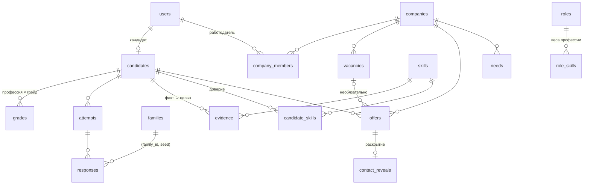

# Модель данных

Две базы PostgreSQL 16: `core` (основная) и `fsp_connector` (данные ФСП), у каждой своя роль. Схема — модели SQLAlchemy в `services/*/…/models.py`, миграции Alembic в `services/core/migrations` и `services/fsp-connector/migrations`. Векторы — `pgvector`.

## Идентичность и профиль

| Таблица | Что хранит |
|---|---|
| `users` | Аккаунт: email, хеш пароля (Argon2), роль, подтверждение email, `is_demo` |
| `refresh_tokens` | Хеши refresh-токенов с семьёй для ротации |
| `email_verifications` | Коды подтверждения email (хеш, попытки, срок) |
| `user_profiles` | Личный профиль сотрудника компании: имя, должность, аватар |
| `consents` | История согласий по типам |
| `candidates` | Анкета: псевдоним, `pseudo_id`, город, вилка, форматы, статус поиска, видимость, стоп-лист, роль и стек, эмбеддинг профиля, командные сигналы, зашифрованные ФИО/контакты/ссылки, возрастная группа и согласие родителя, `profile_version`, мягкое удаление |
| `category_disputes` | Спор кандидата с категорией |
| `resumes`, `experience`, `education` | Загруженные резюме, результат разбора, подтверждённый опыт и образование |
| `telegram_accounts` | Привязка Telegram-чата |
| `candidate_links` | Ссылки кандидата (GitHub и др.) с проверкой доступности |

## Тест

| Таблица | Что хранит |
|---|---|
| `surveys` | История опросов: профессия, стек, форматы, вилка, заявленный грейд |
| `families` | Банк семейств заданий: источник (`code`, `spec`, `llm`, `mutation`, `fsp`), навык и тип, уровень, сложность `b`, число ответов `n`, якорь, статус (`draft → pilot → active → quarantine → retired`), спецификация, статус ключа, `ai_solvable`, статистика пилота, компания-автор, соревнование ФСП |
| `attempts` | Попытка: профессия, заявленный грейд, этап (`main`/`bonus`), режим (`standard`/`express`), статус, план (секции, домен «мира», пилотные позиции, итоги этапов), θ, SE, LLR, индекс честности |
| `responses` | Выданное задание: `(family_id, seed)` без ключа, ответ, балл, время, телеметрия, пилот |
| `grades` | Действующий грейд по профессии: θ, SE, положение в полосе грейда, θ по типам навыков, честность, «требует подтверждения», «низкая уверенность», режим, срок действия, дата следующей смены |
| `regular_tasks`, `task_submissions` | Регулярные задания компании и ответы кандидатов по раундам |
| `family_orders` | Заказы администратора на генерацию заданий LLM |

## Навыки и доказательства

| Таблица | Что хранит |
|---|---|
| `skills` | Навык: slug, название, тип (`fundamental`, `hard`, `thinking`, `business`, `soft`, `experience`), статус (`active`, `provisional`, …), эмбеддинг |
| `skill_aliases`, `skill_relations` | Синонимы; связи «родитель», «смежный» с коэффициентами и источником |
| `skill_distinct`, `skill_blocklist`, `skill_merges` | Пары «точно разные» (Java ≠ JavaScript), запрещённые слова, журнал слияний с откатом |
| `skill_mentions`, `skill_card_drafts` | Журнал упоминаний новых навыков и черновики карточек |
| `roles`, `role_skills` | Профессии и веса навыков в них |
| `disciplines`, `discipline_skill_rules` | Дисциплины ФСП и правила «дисциплина → навыки» |
| `profession_suggestions` | Предложенные системой новые профессии |
| `scoring_config` | Версии конфигурации и подсказки роста графа |
| `evidence` | Доказательство «факт подтверждает навык»: источник (`self`, `resume`, `test`, `fsp`, `task`, …), сила, дата, тип и id факта, детали, верификация. Ключ upsert — `(кандидат, навык, источник, тип факта, id факта)` |
| `candidate_skills` | Агрегат доверия по навыку: confidence, уровень 0–4, источники, топ-доказательства, «только заявлено», унаследовано от дочернего |
| `fsp_participants`, `fsp_competitions`, `fsp_results`, `fsp_ranks`, `fsp_teams`, `fsp_team_members` | Факты ФСП, полученные из событий `fsp.*` |

## Компании, вакансии, подбор

| Таблица | Что хранит |
|---|---|
| `companies` | Компания: название, ИНН, сайт, описание, направление, контакты, логотип, статус модерации, метка «проверена», рейтинг ответственности |
| `company_members`, `company_invites`, `company_access_log` | Участники (`admin`/`member`), приглашения по ссылке, журнал выдачи доступа |
| `vacancies`, `vacancy_skills` | Вакансия с обязательной вилкой, грейдами, форматами, версией; требуемые навыки (обязательные/желательные, минимальный уровень, вес) |
| `matches` | Предрассчитанный подбор вакансия × кандидат со скором, разбором и объяснением |
| `needs` | Потребность работодателя: текст, фильтры, веса навыков, грейды, шорт-лист |
| `category_subscriptions`, `category_subscription_hits` | Подписки компании на категорию и найденные кандидаты |
| `candidate_interests` | Отметка кандидата «интересна эта компания» |
| `impressions`, `rec_feedback` | Показы в выдаче с позицией и признаками; реакции работодателя |
| `profile_views` | Просмотры карточки кандидата компаниями |

## Контакт

| Таблица | Что хранит |
|---|---|
| `offers` | Интерес, приглашение или отклик: компания, кандидат, вакансия (необязательна), вилка и её база, название, описание, способ связи, инициатор, статус, причина отказа, снимок подбора, срок, ключ идемпотентности, командный оффер |
| `offer_events` | Журнал переходов статусов: откуда, куда, кто |
| `offer_messages` | Переписка (сайт или Telegram) |
| `offer_tasks` | Задание в приглашении: семейство, срок, ответ, балл |
| `contact_reveals` | Факт раскрытия контактов и его отзыв |
| `complaints` | Жалобы кандидатов |

## Прочее

| Таблица | Что хранит |
|---|---|
| `notifications` | Уведомления пользователя |
| `issued_credentials` | Выпущенные Open Badge и отзыв |
| `analytics_events` | События аналитики по псевдонимам (партиции по месяцам) |
| `live_runs` | Живые прогоны с участниками и ответы SUS |
| `outbox`, `inbox` | Надёжная доставка событий ([messaging.md](messaging.md)) |

## База `fsp_connector`

| Таблица | Что хранит |
|---|---|
| `fsp_links` | Привязка кандидата к участнику ФСП: метод (`registry`, `oauth`, `code`, `manual`), верификация |
| `fsp_link_conflicts` | Попытки привязать уже привязанного участника |
| `fsp_reg_events`, `fsp_reg_participants`, `fsp_reg_results` | Реестр ФСП у администратора: мероприятия, участники с нормализованными контактами, результаты |
| `fsp_link_requests` | Заявки кандидатов на привязку |
| `raw_responses`, `webhook_log` | Сырые ответы источника и журнал вебхуков (идемпотентность по `event_id`) |
| `outbox`, `inbox` | Как в core |
