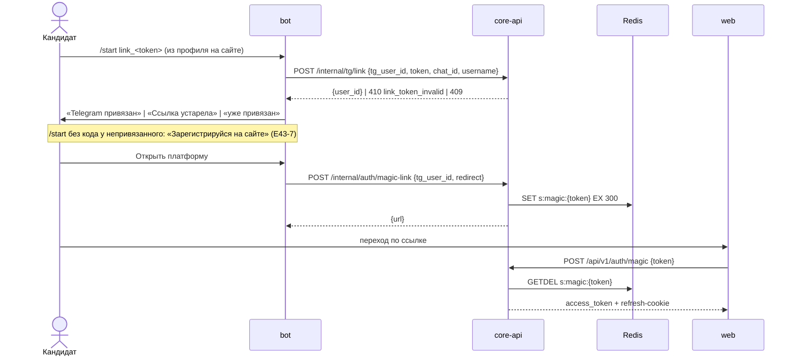
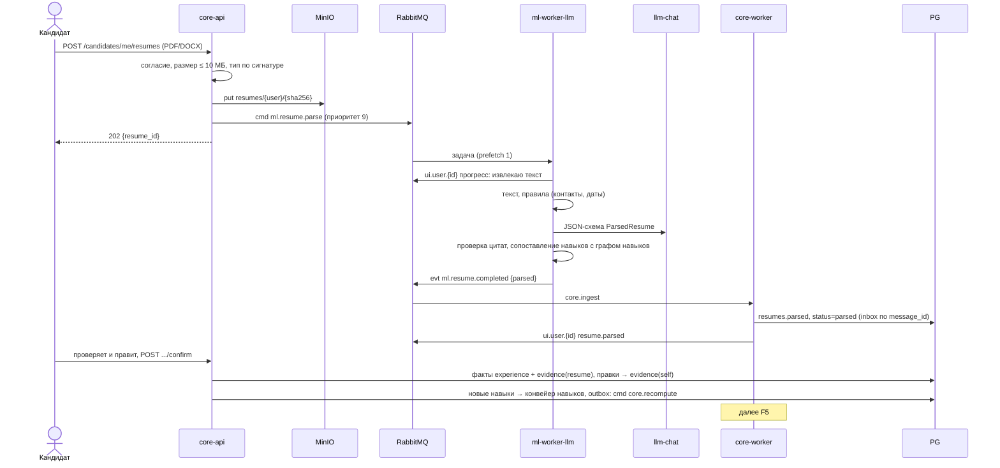
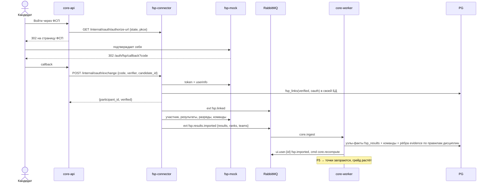
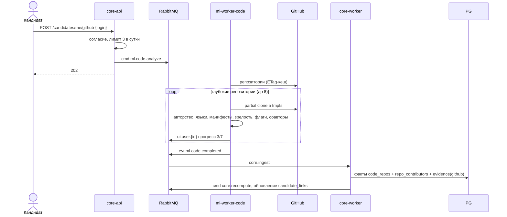
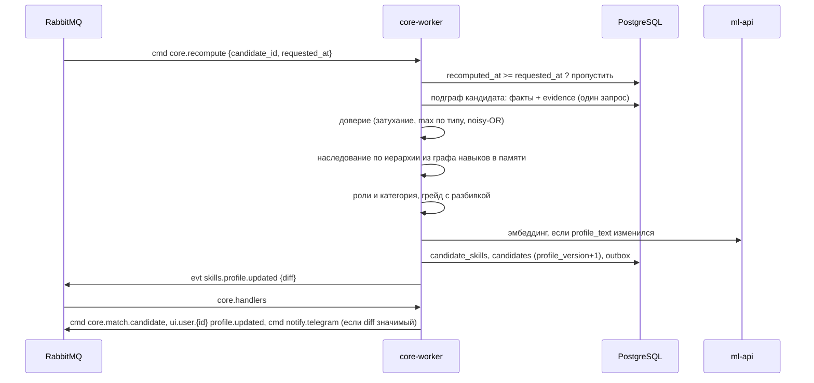
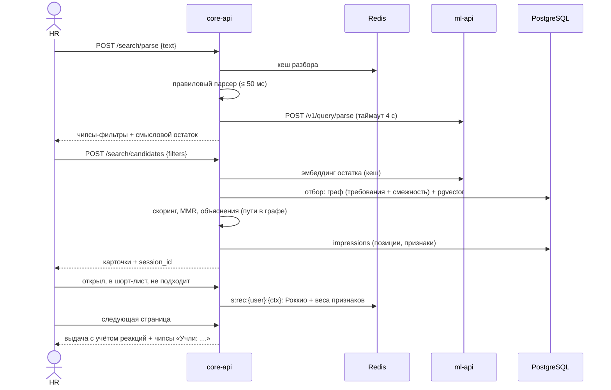
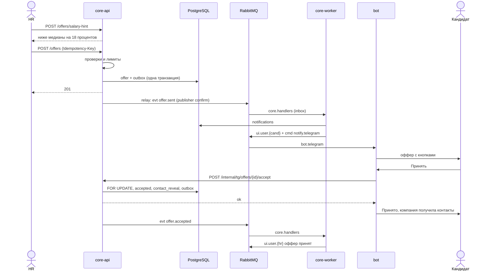
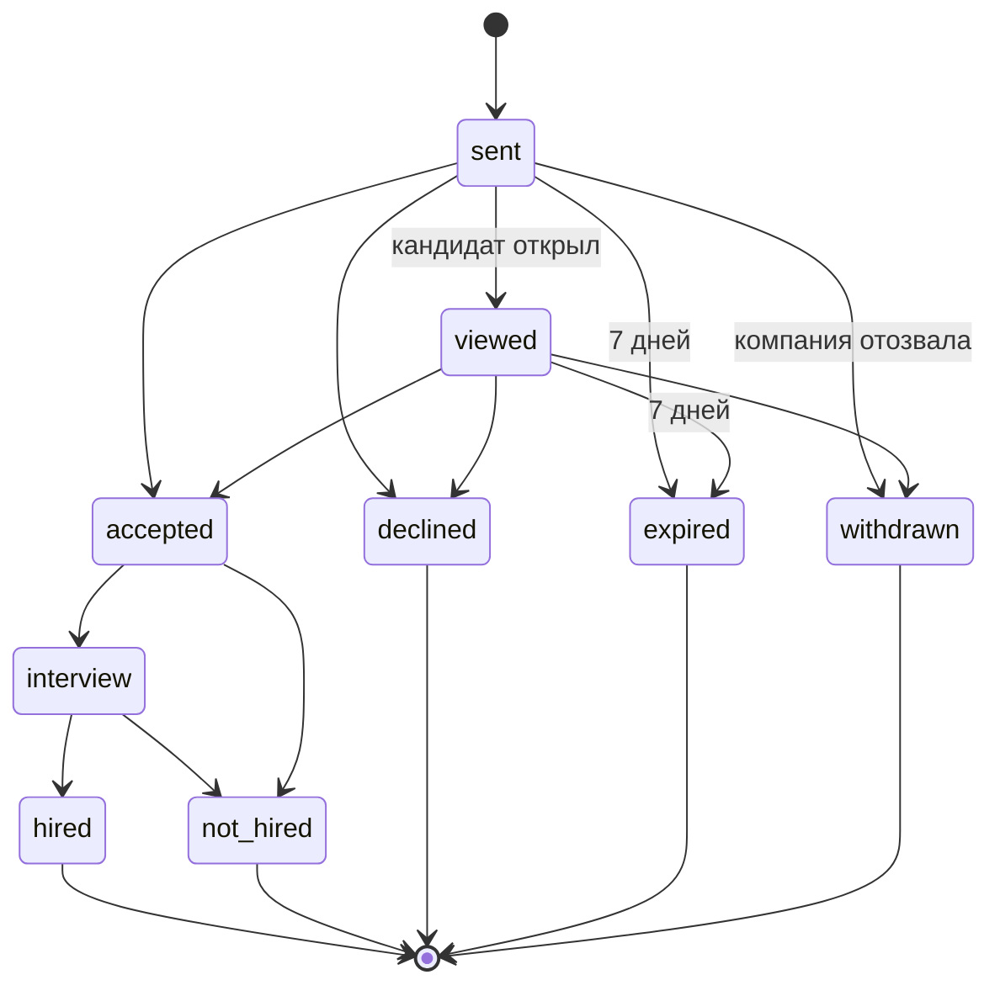
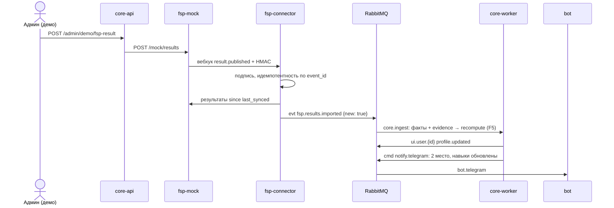
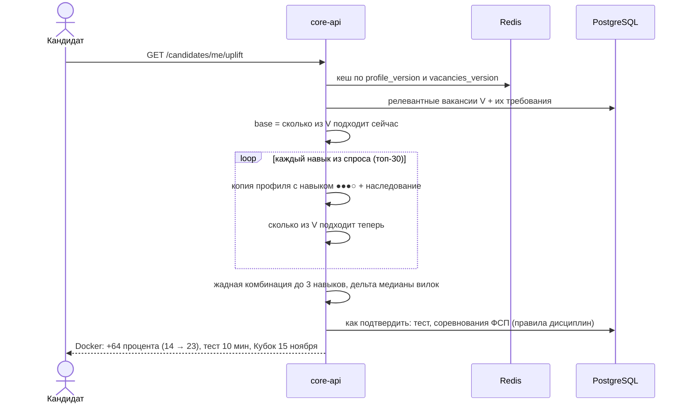

# Флоу системы

Обозначения: `API` = core-api, `CW` = core-worker, `MQ` = RabbitMQ, `MLW` = ml-worker, `FSPC` = fsp-connector, `PG` = PostgreSQL. Очереди и события — [messaging.md](messaging.md), эндпоинты — [api.md](api.md), граф — [graph.md](graph.md).

---

## F1. Вход и регистрация

Способы: email и пароль; Telegram (Telegram Login Widget на сайте; бот только привязывается к готовому аккаунту, E43-7); одноразовая ссылка из бота; «Войти через ФСП» (F3).

- Ссылка живёт 5 минут и срабатывает один раз.
- Telegram Login Widget: проверка `hash` (HMAC с ключом SHA256(bot_token)), `auth_date` ≤ 24 ч.
- Привязка Telegram к аккаунту с email: deep link `t.me/<bot>?start=link_<token>`.

---

## F2. Резюме → факты и доказательства

- Повторная загрузка того же файла не вызывает LLM: кеш по `sha256 + parser_version`.
- В боте файл приходит как `document`, бот стримит его в `POST /internal/tg/resumes`. Подтверждение в боте: «Всё верно» или «Исправить на сайте».
- Скан без текста → OCR (если есть tesseract), иначе `ml.resume.failed`.

---

## F3. Привязка ФСП → факты → навыки «загораются»

| Способ | Верификация | Вес доказательств |
|---|---|---|
| A. «Войти через ФСП» (OAuth, на демо мок) | полная | 100% |
| B. ID или email + код подтверждения | полная | 100% |
| C. Ручной ID | нет | ×0.5, пометка «не верифицировано» |

---

## F4. GitHub → ДНК кода

---

## F5. Пересчёт графа (центральный)

Триггеры: команда `core.recompute` после новых доказательств, `taxonomy.updated` (только затронутым кандидатам), изменение предпочтений.

- **Слияние без задержек:** пачка импорта ставит много команд, но обработчик пропускает те, что уже покрыты более поздним пересчётом.
- **Diff** в событии («алгоритмы ●●○○ → ●●●●, грейд Junior → Junior+») показывают фронт и бот.

---

## F6. Поиск работодателя и подстройка в сессии

Если LLM не уложилась в таймаут, отдаём чипсы правилового парсера с `refining=true`.

---

## F7. Вакансия → подборка

1. `POST /vacancies` → `POST /vacancies/{id}/publish`. Проверки: компания проверена, есть вилка, есть обязательный навык.
2. `evt vacancy.published` → `cmd core.match.vacancy` → отбор и скоринг по всем видимым кандидатам → `matches` (топ-200) → `ui.user.{hr}` «подборка готова».
3. `cmd ml.matches.explain` (приоритет 2) → обоснования для топ-5 → `evt ml.matches.explained`.
4. `evt skills.profile.updated` → `cmd core.match.candidate` → пересчитать строки `matches` этого кандидата по всем открытым вакансиям. Новый кандидат в топе вакансии с подпиской → уведомление.

---

## F8. Оффер → Telegram → решение → контакты

Отклонение: бот показывает причины кнопками → `POST /internal/tg/offers/{id}/decline {reason}`. Вопросов работодателю из бота нет (E39-26: вместо переписки одно сообщение при приглашении и один ответ на сайте). «Подробнее» — одноразовая ссылка на сайт.

Вопросы не меняют статус: у оффера флаг `awaiting_reply_from`.

---

## F9. Адаптивный тест

1. `POST /assessment/tests {skill_id}` (или `/internal/tg/tests` из бота) → сессия в Redis `s:test:{id}` (θ, SE, заданные вопросы) + строка `test_sessions`.
2. Следующий вопрос — максимум информации Фишера в текущей θ ([ml.md §8](ml.md#8-адаптивный-тест)).
3. Остановка: ≥ 5 вопросов и SE < 0.45, или 8 вопросов. 60 с на вопрос.
4. Результат → факт `test_sessions` + `evidence(test)` → `cmd core.recompute`. В боте: «Python ●●○○ → ●●●○».
5. Пересдача — через 30 дней (в демо-режиме без ограничения). Результат действует 12 месяцев.

---

## F10. ИИ-интервью

1. Условие: есть глубоко разобранный репозиторий с долей авторства ≥ 50%.
2. `cmd ml.interview.generate` (приоритет 7) → 3 фрагмента кода кандидата → вопросы + рубрики → `evt ml.interview.generated`.
3. Ответы текстом (🚀 голосом через whisper.cpp), по 3 минуты.
4. `cmd ml.interview.grade` (приоритет 8) → оценки 0–3 → `evt ml.interview.graded` → факт `interview_sessions` + `evidence(ai_interview)` + подтверждение авторства репозитория → `cmd core.recompute`.

---

## F11. Новый результат ФСП → профиль обновился → push

Если у реального API ФСП нет вебхуков, работает фолбэк `fsp.sync_all` раз в час.

---

## F12. Расписание

`core-scheduler` публикует команды в `core.jobs` и `fsp.sync`: истечение офферов (5 мин), сброс «активно ищу» (1 ч), карта рынка (2 мин при изменениях), синхронизация ФСП и календаря (1 ч), рейтинг компаний (1 ч), `candidate_links` (10 мин при импортах), очистка (сутки). Таблица — [messaging.md §4](messaging.md#4-расписание).

---

## F13. Удаление профиля

1. `DELETE /candidates/me` (подтверждение паролем или фразой) → в одной транзакции: скрыт из поиска (`deleted_at`), согласия отозваны, стёрты резюме и файлы, доказательства, навыки, тесты и грейды, ПДн анкеты и учётной записи; `evt candidate.deleted`.
2. core-worker: удаляет факты, доказательства, `candidate_skills`, эмбеддинг, файлы в MinIO, Telegram-привязку. В офферах остаётся только псевдоним.
3. fsp-connector по тому же событию удаляет `fsp_links` и сырые данные участника.
4. Отзыв отдельного согласия удаляет связанные данные: `fsp_data` → факты ФСП, `code_analysis` → репозитории и интервью. Затем F5.

---

## F14. Uplift: какой навык подтвердить, чтобы подходить под N% больше вакансий

Бот присылает лучший uplift после обновления профиля или раз в неделю, если прирост ≥ 15%. Подробно — [matching.md §6](matching.md#6-uplift-для-кандидата-какой-навык-добавить).
