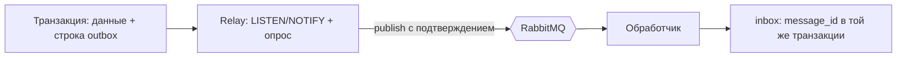

# События, команды и очереди

Сервисы общаются через RabbitMQ (библиотека FastStream). Все схемы — pydantic-модели в `packages/contracts`, полный каталог — [asyncapi.json](../asyncapi.json) (`make asyncapi`).

## Конверт

Каждое сообщение — `Envelope`: `message_id`, `type`, `schema_version`, `producer`, `occurred_at`, `correlation_id`, `payload`. Ломающее изменение схемы — новый `schema_version` или новое имя события.

## Топология

| Обменник | Тип | Назначение |
|---|---|---|
| `events` | topic | Доменные события, ключ маршрутизации = тип события |
| `commands` | direct | Команды, ключ = имя очереди-получателя |
| `ui` | topic | Сообщения для SSE: `ui.user.<id>` |
| `dlx` | direct | Сообщения, исчерпавшие повторы → `<очередь>.dlq` |

| Очередь | Слушает | Prefetch | Потребитель |
|---|---|---|---|
| `core.ingest` | `fsp.results.imported`, `fsp.competitions.updated`, `fsp.linked`, `ml.#` | 8 | core-worker |
| `core.handlers` | `evidence.changed`, `skills.profile.updated`, `vacancy.#`, `offer.#`, `candidate.#`, `taxonomy.updated`, `matches.ready` | 8 | core-worker |
| `core.recompute` | команда пересчёта профиля | 4 | core-worker |
| `core.match` | команды подбора под вакансию / кандидата | 4 | core-worker |
| `core.jobs` | команды по расписанию | 2 | core-worker |
| `core.analytics` | все события (`#`) | 20 | core-worker |
| `ml.llm` | команды LLM, приоритет 0–10 | 1 | ml-worker-llm |
| `ml.code` | анализ кода | 2 | ml-worker-code |
| `fsp.sync` | синхронизация ФСП | 4 | fsp-connector-worker |
| `bot.telegram` | `notify.telegram` | 10 | bot |

**Повторы.** Ошибка обработчика → копия сообщения в `<очередь>.retry.5s`, затем `.30s`, `.2m` (TTL + dead-letter обратно), счётчик — заголовок `x-retry`. После трёх повторов — `<очередь>.dlq`.

**Одна GPU.** Очередь `ml.llm` с `prefetch=1` и приоритетами: разбор резюме (9) обгоняет фоновую генерацию заданий (0). Core в LLM напрямую не ходит.

## Outbox и inbox

- Событие пишется в `outbox` в одной транзакции с изменением данных — потерять его при падении нельзя.
- Relay публикует с publisher confirms и помечает отправленное.
- Обработчик в своей транзакции вставляет `message_id` в `inbox`; повторная доставка отбрасывается.
- Обработчики сверяют версии (`profile_version`, `vacancy.version`), а пересчёт профиля пропускается, если `recomputed_at ≥ requested_at`: пачка доказательств даёт 1–2 пересчёта.

## Основные события

| Событие | Кто пишет | Кто читает | Смысл |
|---|---|---|---|
| `candidate.registered`, `candidate.preferences.updated`, `candidate.deleted` | core/candidates | подбор, аналитика, сервисы | Жизненный цикл анкеты; удаление — сигнал всем стереть свои данные |
| `assessment.attempt.finished` | core/assessment | уведомления, аналитика | Итог попытки: результат, θ, честность, приглашение на следующий грейд |
| `candidate.category.changed` | core/assessment | подписки на категории, подбор | Полный набор действующих категорий кандидата |
| `candidate.visibility.changed` | core/candidates | кеш выдачи | Изменились настройки видимости |
| `evidence.changed` → `skills.profile.updated` | core/graph | подбор, uplift | Новые доказательства → пересчёт доверия |
| `resume.parsed`, `resume.confirmed` | core/resumes | аналитика | Разбор резюме готов / подтверждён |
| `vacancy.published|updated|closed` | core/vacancies | подбор | Пересчёт подборки под вакансию |
| `offer.sent|viewed|accepted|declined|expired|withdrawn|message|status_changed` | core/offers | уведомления, бот, аналитика | Автомат статусов приглашения и отклика |
| `offer.interest.*` | core/offers | уведомления | Интерес до приглашения |
| `regular_task.published` | core/assessment | уведомления | Рассылка регулярного задания категории |
| `fsp.linked`, `fsp.results.imported`, `fsp.competitions.updated` | fsp-connector | core/graph | Привязка и новые результаты ФСП |
| `ml.resume.completed|failed`, `ml.families.started|generated` | ml | core | Результаты асинхронных LLM-задач |
| `taxonomy.updated` | core/taxonomy | ml (снимок справочника) | Новая версия графа навыков |

## Команды

| Команда | Очередь | Назначение |
|---|---|---|
| `ml.resume.parse` | `ml.llm` (9) | Разобрать резюме |
| `ml.families.generate` | `ml.llm` (0) | Сгенерировать черновики заданий по заказу администратора |
| `fsp.sync`, `fsp.sync_all` | `fsp.sync` | Синхронизировать результаты кандидата или всех привязок |
| `notify.telegram` | `bot.telegram` | Отправить или отредактировать сообщение в Telegram |
| `core.recompute` | `core.recompute` | Пересчитать профиль кандидата |
| `core.match.vacancy`, `core.match.candidate` | `core.match` | Пересчитать подбор |
| `offers.expire`, `active_status.expire`, `market.refresh`, `company.rating`, `candidate_links.refresh`, `cleanup`, `taxonomy.professions.suggest` | `core.jobs` | Задачи по расписанию (`core-scheduler`) |

## Расписание

| Команда | Период |
|---|---|
| `offers.expire` | 5 мин |
| `market.refresh` | 2 мин |
| `candidate_links.refresh` | 10 мин |
| `active_status.expire`, `fsp.sync_all`, `company.rating` | 1 ч |
| `cleanup` | 24 ч |
| `taxonomy.professions.suggest` | 7 дней |

## Redis

Кеш страниц выдачи (60 с, ключ включает версию каталога и согласий), кеш публичной статистики (5 мин), кеш uplift и эмбеддингов, лимиты запросов, одноразовые токены (magic-ссылки, deep link бота), состояние диалогов бота. Всё с TTL: потеря Redis не теряет данные.

## SSE

`GET /events/stream` держит поток событий для пользователя: core подписывает свою очередь `ui.<instance>` на `ui.user.*` и раздаёт сообщения подключённым клиентам. Heartbeat каждые 20 с; при недоступном брокере REST работает, поток молчит.
