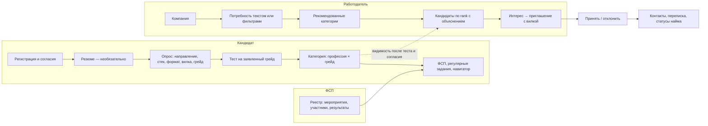
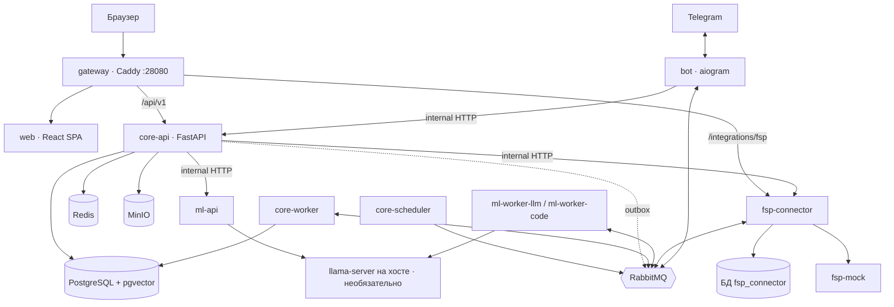
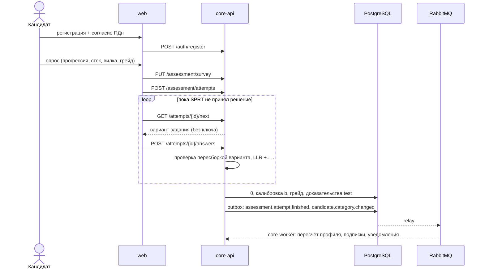
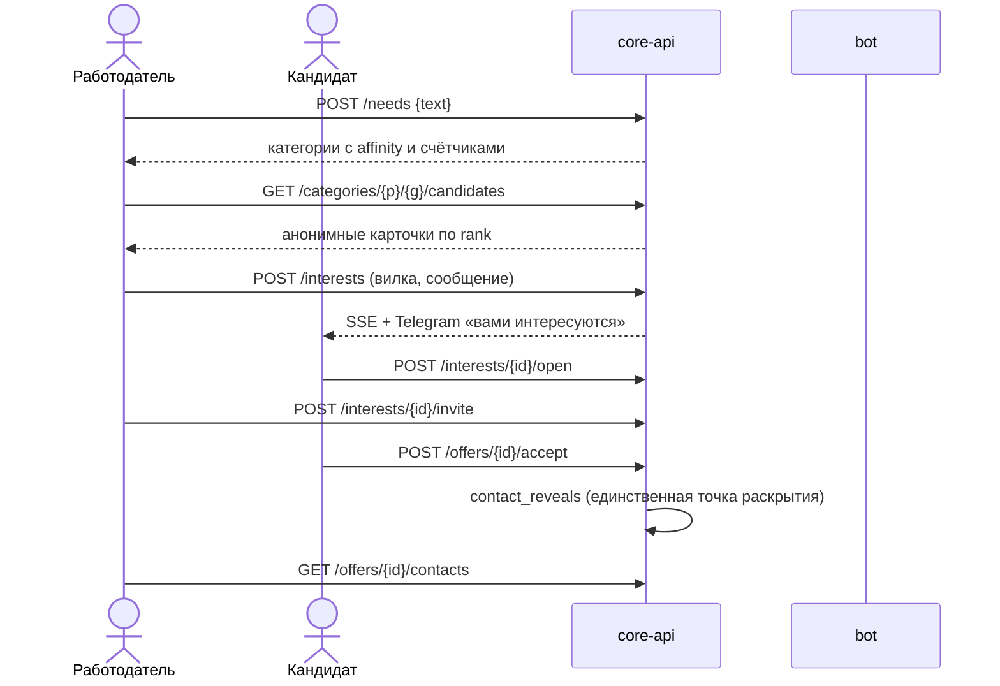

# Архитектура

ФСП Карьера — модульный монолит `core` и несколько сервисов-спутников, связанных шиной RabbitMQ. Почему так — [ADR-0001](../adr/0001-modular-monolith-and-satellites.md).

## Функциональная архитектура

Пять функциональных блоков:

| Блок | Что делает | Где описано |
|---|---|---|
| Идентичность и профиль | Регистрация, вход, роли, согласия, анкета, резюме, видимость | [security.md](security.md), [features.md](../product/features.md) |
| Тест и категоризация | Опрос, генерация вариантов, адаптивный тест, грейды, банк заданий | [assessment.md](../mechanics/assessment.md) |
| Доказательства и доверие | Граф навыков, доказательства из теста, резюме, ФСП, заданий; доверие к навыку | [skills.md](../mechanics/skills.md) |
| Подбор и контакт | Потребность → категории → кандидаты, поиск, интерес, приглашения, отклики, раскрытие контактов | [matching.md](../mechanics/matching.md), [contact.md](../mechanics/contact.md) |
| Интеграции | ФСП (реестр, мок, синхронизация), Telegram, ML/LLM | [fsp.md](../mechanics/fsp.md), [ml.md](../mechanics/ml.md) |

## Компонентная архитектура

| Компонент | Технологии | Назначение |
|---|---|---|
| `web` | React 19, Vite, TypeScript, Tailwind 4, TanStack Query, `@fsp/ui` | SPA для трёх ролей; данные только через сгенерированный из OpenAPI клиент |
| `gateway` | Caddy 2 | Единая точка входа, роутинг по Host и пути, SSE без буферизации, `/internal/*` наружу закрыт |
| `core-api` | FastAPI, SQLAlchemy 2 async, Pydantic v2 | REST API, SSE `/events/stream` |
| `core-worker` | FastStream | Обработчики очередей `core.*`, ретранслятор outbox |
| `core-scheduler` | APScheduler | Команды по расписанию: истечение офферов, синхронизация ФСП, рейтинг компаний, предложения профессий |
| `ml-api` | FastAPI, sentence-transformers | Эмбеддинги, разбор запроса, сопоставление навыков, черновики ключей и объяснений |
| `ml-worker-llm`, `ml-worker-code` | FastStream | Разбор резюме и генерация заданий через очередь `ml.llm` (приоритеты, `prefetch=1`) |
| `fsp-connector` | FastAPI, своя БД | Порт ФСП, реестр, привязка, синхронизация, вебхук |
| `fsp-mock` | FastAPI | Имитация API ФСП с OAuth 2.0 + PKCE и OIDC discovery |
| `bot` | aiogram 3 | Telegram-канал без бизнес-логики |
| PostgreSQL 16 + pgvector | — | Данные core и fsp-connector (две базы, свои роли) |
| RabbitMQ | — | События, команды, UI-шина для SSE |
| Redis | — | Кеш выдачи, лимиты, одноразовые токены, сессии бота |
| MinIO | — | Резюме, аватары, логотипы |

Модули `core` (`services/core/app/*`) общаются только через `service.py` друг друга; в чужие модели и репозитории не ходят. Сервисы-спутники не ходят в БД `core`: только события, команды и internal API с сервисными токенами. Подробнее — [modules.md](modules.md).

## Ключевые потоки

### Регистрация → тест → категория

### Потребность → приглашение → контакты

### Результат ФСП → профиль

`fsp-connector` получает новые результаты (вебхук, синхронизация по расписанию или кнопке) → пишет `fsp.results.imported` в свой outbox → `core-worker` сохраняет факты, пересобирает доказательства `fsp` по правилам «дисциплина → навыки» → пересчёт доверия к навыкам и силы профиля → уведомление кандидату.

## Надёжность сообщений

- Событие пишется в таблицу `outbox` в той же транзакции, что и данные; ретранслятор публикует его с подтверждением брокера.
- Обработчики идемпотентны: id сообщения фиксируется в `inbox` в той же транзакции, повтор отбрасывается.
- Ошибка обработчика → очередь задержки 5 с → 30 с → 2 мин → DLQ.

Подробно — [messaging.md](messaging.md).

## Масштабирование и интеграция

- Модули `core` уже общаются событиями из `packages/contracts`: любой можно вынести в сервис без смены контрактов.
- Поиск и подбор работают в памяти поверх SQL-фильтров (сотни–тысячи анкет); при росте до сотен тысяч — отдельная read-модель поиска из outbox.
- Новый источник ФСП — новый адаптер `FspPort` с маппингом; ядро не меняется.
- LLM — сменный модуль за `ml-api` и очередью `ml.llm`: локальная модель, облачный OpenAI-совместимый провайдер или без LLM вовсе.

## Концепции за рамками MVP

**Защита от фиктивных вакансий и недобросовестных работодателей.** Уже есть: модерация компании (`pending → verified/rejected/blocked`), метка «проверена» для кандидатов, лимиты интересов и приглашений, обязательная вилка, жалобы кандидатов с разбором администратором, рейтинг ответственности компании (доля принятых приглашений со штрафами за отозванные и просроченные), предупреждение о вилке ниже ожиданий кандидата. Дальше: проверка ИНН по ЕГРЮЛ и домена почты, скоринг риска вакансии (вилка вне рынка, массовые приглашения без найма, повторные жалобы), автоматическое снижение в выдаче и блокировка, публичная история найма компании.

**Интеграция с ATS.** Работодатель подключает ATS по OAuth-токену компании. Платформа отдаёт вебхуки `offer.accepted`, `offer.status_changed`, отклики и шорт-лист в формате ATS (кандидат со ссылкой на анонимную карточку, контакты — только после принятия); из ATS принимаются вакансии и статусы найма (`interview`, `hired`, `not_hired`). Внутри это ещё один потребитель событий `offer.*` и адаптер на каждую ATS, по образцу `FspPort`.

**Дальше по дорожной карте:** настоящий FSP ID на Keycloak вместо мока, обучение ранжирования на накопленных показах и реакциях, объективный тест для дизайнеров (ревью макета с внесёнными дефектами), Telegram Mini App.
