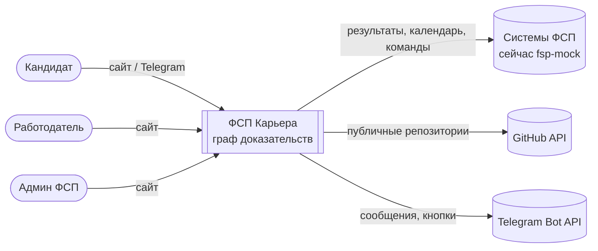
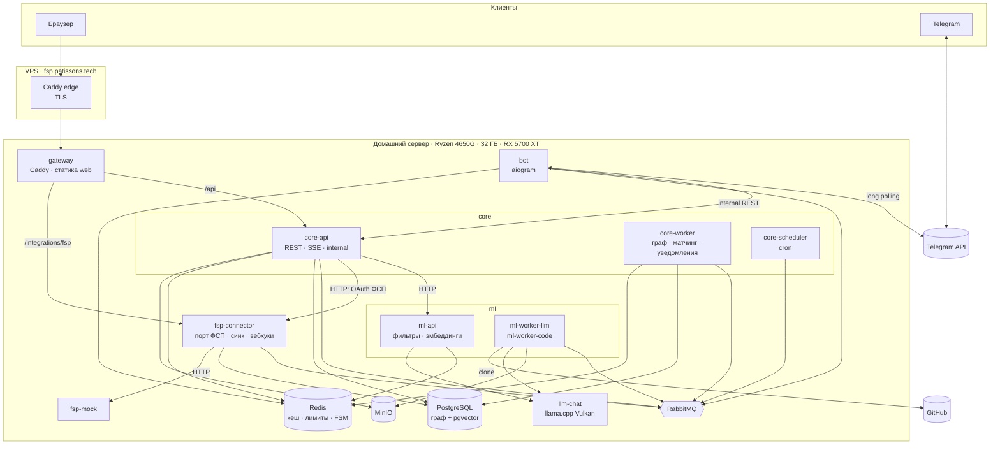

# Архитектура: обзор

> Статус: **v0.2** (2026-10-02): пять логических сервисов, RabbitMQ как шина, граф доказательств как центральная модель, рекомендации и uplift. ⚠️ — допущения до спецификации API ФСП и ответов экспертов.
> Продукт: [product.md](../product.md).

## 1. Идея в одном абзаце

Профиль кандидата — **граф доказательств**: кандидат → проверяемые факты (результаты ФСП, репозитории, тесты, опыт) → навыки, которые эти факты подтверждают с силой и датой. Из графа считаются доверие к навыкам (○○○○…●●●●), категория, грейд, подбор с объяснениями («каждый ✓ — путь в графе»), похожие кандидаты и uplift для кандидата («подтверди Docker — подойдёшь под 64% больше вакансий»). Эмбеддинги — смысловой слой поверх графа и один из признаков ранжирования. Подробно: [graph.md](graph.md), [matching.md](matching.md).

## 2. Принципы

1. **Пять понятных сервисов, а не десяток микросервисов.** web, core, ml, fsp-connector, bot. Каждый со своим смыслом и владельцем. Внутри core — модули с жёсткими границами (ADR-012).
2. **Граф — источник правды, обход при записи.** Глубокие вычисления идут при поступлении фактов. Чтение использует готовые проекции и максимум один шаг по смежности навыков (ADR-013).
3. **Ядро детерминировано и объяснимо.** Доверие, грейд и скоринг считаются по формулам из конфига. LLM только извлекает структуру и формулирует текст (ADR-008).
4. **Между сервисами — RabbitMQ.** События, команды, задачи для единственной GPU с приоритетами, уведомления. Outbox и inbox: ничего не теряется и не дублируется (ADR-012, ADR-015).
5. **Внешние системы спрятаны.** ФСП — за fsp-connector и портом `FspPort`, LLM — за клиентом с профилями, GitHub — в ml.
6. **Данные кандидатов не уходят наружу.** Модели только локальные.
7. **Демо воспроизводимо.** Seed, снапшот, `make demo-reset`.

## 3. Контекст (C4, уровень 1)

## 4. Контейнеры (C4, уровень 2)

| Откуда → куда | Как | Зачем |
|---|---|---|
| web → core-api | REST `/api/v1`, SSE `/api/v1/events/stream` | Всё API продукта, живые обновления |
| bot → core-api | REST `/internal/tg/*` | Действия пользователя с мгновенным ответом |
| core-api → ml-api | HTTP, таймаут 2–5 с, фолбэк | Текст → фильтры, эмбеддинг запроса |
| core-api → fsp-connector | HTTP | URL авторизации ФСП и обмен кода |
| core ↔ ml-worker | RabbitMQ: команды `ml.*` → события `ml.*.completed` | Резюме, GitHub, интервью, обоснования |
| core ↔ fsp-connector | RabbitMQ: команда `fsp.sync` → события `fsp.results.imported`, `fsp.competitions.updated` | Факты ФСП в граф |
| core → bot | RabbitMQ: команда `notify.telegram` | Push в Telegram |
| core-worker / ml-worker → core-api | RabbitMQ: `ui.user.<id>` | SSE на сайт: прогресс, «точки загорелись», «оффер принят» |

## 5. Сервисы (кратко)

Подробно: [services.md](services.md).

| Сервис | Отвечает за | Данные | Владелец |
|---|---|---|---|
| `web` | Весь интерфейс | — | Frontend |
| `core` (api + worker + scheduler) | Аккаунты, **граф доказательств**, вакансии, поиск, рекомендации, офферы, админка | БД `core`, MinIO | Backend-1 (+ Backend-2: офферы, уведомления, вакансии) |
| `ml` (api + 2 воркера) | Резюме, ДНК кода, текст → фильтры, эмбеддинги, интервью | без БД, кеш в Redis | ML |
| `fsp-connector` | Порт ФСП, привязка, синхронизация, вебхуки, календарь | БД `fsp_connector` | Backend-2 |
| `bot` | Telegram | FSM в Redis | Backend-2 / Frontend |
| `fsp-mock` | Имитация ФСП | своя SQLite | Backend-2 |

## 6. Стек (кратко)

Подробно: [stack.md](stack.md).

- **Бэкенд:** Python 3.12, FastAPI, Pydantic v2, SQLAlchemy 2 async + Alembic, **FastStream + RabbitMQ**, uv workspace.
- **ML:** llama.cpp server (Vulkan) с моделью класса Qwen 7–8B Q4, bge-m3 на CPU, PyMuPDF, rapidfuzz, pymorphy3.
- **Фронт:** React + Vite + TS, TanStack Query, orval, Tailwind + shadcn/ui, ECharts (включая граф).
- **Данные:** PostgreSQL 16 + pgvector + pg_trgm, Redis 7, MinIO.
- **Инфра:** Docker Compose, Caddy, WireGuard, GitHub Actions.

## 7. Ключевые потоки

Диаграммы: [flows.md](flows.md).

| # | Поток | Как |
|---|---|---|
| F1 | Вход: бот, Telegram Login, email, ссылка из бота | sync |
| F2 | Резюме → факты и доказательства → подтверждение | RabbitMQ + SSE |
| F3 | Привязка ФСП → факты → навыки «загораются» | RabbitMQ + SSE |
| F4 | GitHub → ДНК кода → факты-репозитории | RabbitMQ + SSE |
| F5 | **Пересчёт графа:** доказательства → доверие с наследованием → категория → грейд → эмбеддинг → матчи | RabbitMQ |
| F6 | Поиск работодателя: текст → чипсы → выдача → подстройка в сессии | sync |
| F7 | Вакансия → подборка → объяснения | RabbitMQ |
| F8 | **Оффер → push в Telegram → принять / отклонить / вопрос → контакты** | sync + RabbitMQ |
| F9 | Адаптивный тест | sync |
| F10 | ИИ-интервью | RabbitMQ |
| F11 | Новый результат ФСП → вебхук → профиль обновился → push | RabbitMQ |
| F12 | Расписание | core-scheduler → RabbitMQ |
| F13 | Удаление профиля | RabbitMQ |
| F14 | **Uplift:** какой навык подтвердить, чтобы подходить под N% больше вакансий | sync + бот |

## 8. Карта документов

| Документ | Что внутри |
|---|---|
| [graph.md](graph.md) | **Граф доказательств:** вершины, рёбра, хранение в PostgreSQL, проекции, обходы, API подграфа, связи людей |
| [matching.md](matching.md) | **Рекомендации:** отбор, ранжирование, переранжирование, uplift, подстройка в сессии, логирование показов, дорожная карта (генеративная модель) |
| [skills.md](skills.md) | **Граф навыков:** ядро + рост, модерация, склейка синонимов, жизненный цикл вершин, командные сигналы и `K_soft` |
| [metrics.md](metrics.md) | **Метрики:** 4 контура (качество, продуктовые события, живые прогоны, технические), трекинг-план, хранение, определения, дашборды |
| [evaluation.md](evaluation.md) | **Данные:** эталоны и разметка, синтетический рынок, демо-витрина, стенд оценки и целевые значения |
| [services.md](services.md) | Сервисы, модули core, владельцы, трассировка требований |
| [messaging.md](messaging.md) | RabbitMQ: обменники, очереди, приоритеты, outbox/inbox, ретраи, расписание. Redis: кеш, лимиты |
| [flows.md](flows.md) | Флоу F1–F14 |
| [data-model.md](data-model.md) | DDL таблиц (вершины и рёбра графа, офферы, служебные) |
| [api.md](api.md) | REST, схемы, SSE, internal, callback бота |
| [ml.md](ml.md) | Модели и железо, формулы доверия, грейда и матчинга, тест, ДНК кода, оценка качества |
| [fsp.md](fsp.md) | fsp-connector: порт, предполагаемый API, мок, верификация, синхронизация, правила дисциплин |
| [telegram.md](telegram.md) | Бот |
| [frontend.md](frontend.md) | SPA, маршруты, компоненты, визуализация графа |
| [security.md](security.md) | Аутентификация, анонимность, согласия, песочница кода |
| [deployment.md](deployment.md) | Топология, compose, GPU, окружение, demo-reset |
| [stack.md](stack.md) | Стек и обоснования |
| [decisions.md](decisions.md) | Журнал решений |
