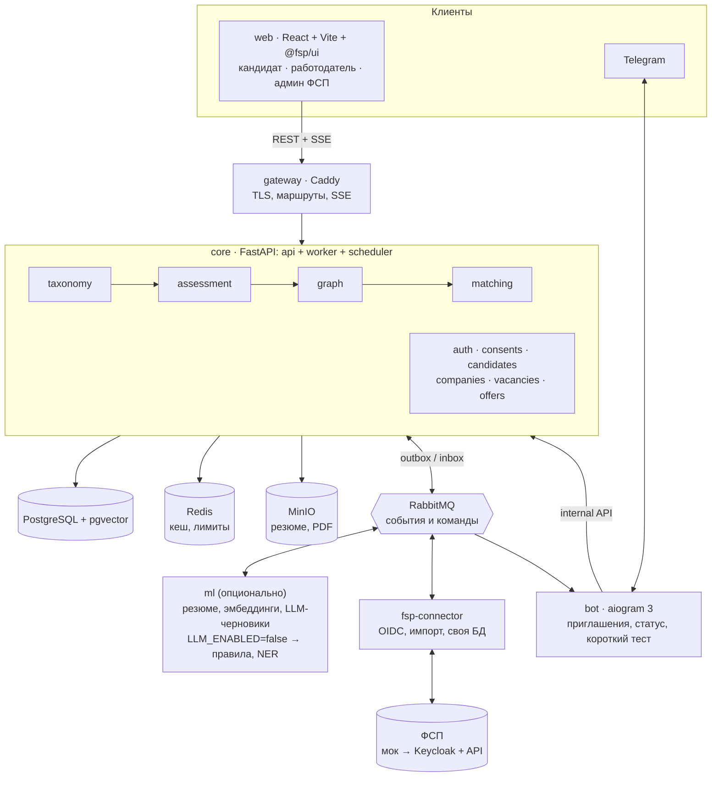
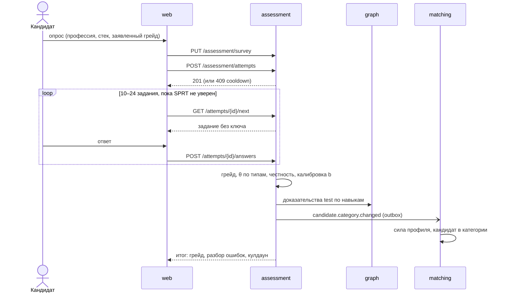
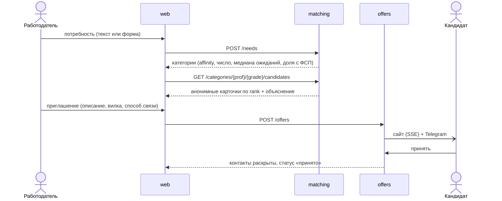
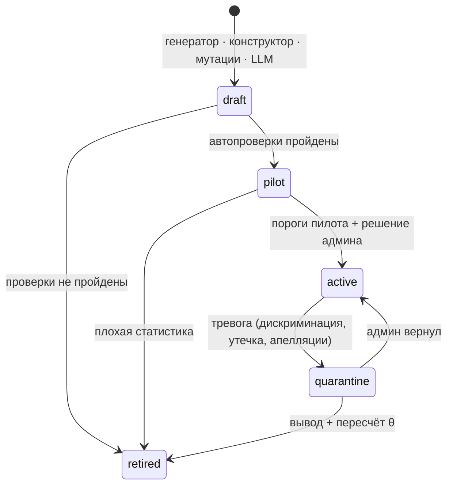
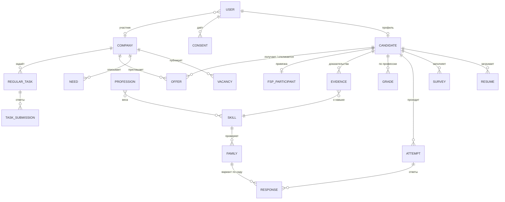

# ФСП Карьера — архитектура решения

> Документ для защиты (рабочая версия v2). Подробности в репозитории: `docs/architecture/assessment.md` (тест и ранжирование), `docs/solution.md` (решение), `docs/architecture/decisions.md` (ADR).

## 1. Одной фразой

Модульный монолит на FastAPI плюс спутники: ML, коннектор ФСП и Telegram-бот. Центр системы — модуль тестирования: он определяет категорию кандидата (профессия × грейд) по тесту, а не по резюме. Подбор ранжирует кандидатов внутри категории по силе подтверждённого профиля.

## 2. Схема

### 2.1. Контейнеры



### 2.2. Модули ядра и связи


### 2.3. Тест: от опроса до категории



### 2.4. Работодатель: от потребности до контакта



### 2.5. Жизненный цикл задания



## 3. Компоненты и зачем они

| Компонент | Роль | Почему так |
|---|---|---|
| **web** | Одно SPA на все роли, данные только через сгенерированный клиент (orval из OpenAPI) | Один проект, одна дизайн-система; контракт с бэкендом проверяется типами |
| **gateway** | Caddy: TLS, маршрутизация по доменам, SSE без буферизации | Наружу открыт один порт |
| **core** | Вся доменная логика: модули с явными границами | Транзакции без распределённых саг; любой модуль можно вынести в сервис |
| **ml** | Разбор резюме, эмбеддинги, LLM-черновики | Другой профиль нагрузки (CPU/GPU); можно выключить |
| **fsp-connector** | Порт к ФСП: вход, привязка ID, импорт результатов, своя БД | Внешняя система изолирована: замена мока на реальное API не трогает core |
| **bot** | Канал уведомлений и короткого теста | Без бизнес-логики, ходит в core через internal API |
| **PostgreSQL + pgvector** | Данные, граф доказательств, векторный поиск | Фильтры, полнотекстовый и векторный поиск в одном запросе — без отдельного Elasticsearch и векторной БД |
| **RabbitMQ** | События и команды между сервисами | Приоритетная очередь для GPU, подтверждения доставки |
| **Redis** | Кеш, лимиты, короткое состояние | Всё с TTL |
| **MinIO** | Резюме и PDF-профили | S3-совместимо |

**Стек:** Python 3.12, FastAPI, SQLAlchemy 2 (async), Alembic, FastStream; React, Vite, TypeScript, Tailwind, shadcn/Radix; aiogram 3; Docker Compose. Всё с открытыми лицензиями.

## 4. Модули core и их границы

```
taxonomy → assessment → graph → matching
```

| Модуль | Что делает |
|---|---|
| `taxonomy` | Навыки шести типов (фундамент, хард, мышление, бизнес, софт, опыт), профессии как веса навыков, пороги грейдов |
| `assessment` | Опрос, попытки, семейства заданий, мир, оценка, грейды, кулдауны, жизненный цикл заданий, конструктор |
| `graph` | Доказательства (тест, ФСП, резюме, задания), доверие к навыкам, сила ФСП |
| `matching` | Категория, сила профиля, потребность → категории → кандидаты, объяснения |
| `offers` | Приглашения и отклики — один автомат статусов, раскрытие контактов |

**Правила:**
- Модули общаются только через `service.py` друг друга; проверка — import-linter в CI.
- Сервисы ml, fsp-connector и bot не ходят в БД core: только события, команды и internal API.

## 4.1. Из каких блоков состоит решение

| Блок | Что даёт пользователю | Модули и сервисы |
|---|---|---|
| **Доступ и согласия** | Регистрация по email, вход через ФСП ID и Telegram, согласия по 152-ФЗ | `auth`, `consents`, fsp-connector |
| **Профиль кандидата** | Анкета, резюме с разбором, PDF-профиль, приватность | `candidates`, `resumes`, ml |
| **Модель навыков** | Навыки шести типов, профессии, грейды, карточки | `taxonomy` |
| **Тестирование** | Опрос, тест в своём мире, грейд, разбор ошибок, пересдачи | `assessment` |
| **Банк заданий** | Генераторы, конструктор, мутации, пилоты, допуск админом | `assessment`, ml (офлайн) |
| **Доверие** | Доказательства из теста, ФСП, резюме и заданий; честность прохождения | `graph`, `assessment` |
| **ФСП** | Привязка ID, импорт достижений, вебхук | fsp-connector, `graph` |
| **Подбор** | Потребность → категории → кандидаты с объяснением, шорт-лист | `matching` |
| **Контакт** | Приглашения и отклики, статусы, раскрытие контактов, сообщения | `offers`, `notifications`, bot |
| **Регулярные задания** | Задачи работодателя категории, ответы, свежесть профиля | `assessment`, bot |
| **Админка ФСП** | Профессии, карточки, очередь допуска, модерация, дашборд | `admin`, `analytics` |
| **Метрики** | Офлайн-отчёт качества, воронки, страница качества | `analytics`, `tools/eval` |

## 4.2. Сущности



| Сущность | Суть | Ключевые поля |
|---|---|---|
| **User** | Аккаунт и роль | email (подтверждён), роль, Telegram |
| **Consent** | Согласие с версией | тип: обработка, показ работодателям, раскрытие контактов, уведомления |
| **Candidate** | Профиль | псевдоним, контакты (скрыты), предпочтения, видимость |
| **Resume** | Файл и результат разбора | навыки с цитатами, опыт, «заявлено» |
| **Survey** | Ответы опроса | профессия, стек, формат, вилка, заявленный грейд |
| **Skill** / **Profession** | Справочник | тип навыка; веса навыков профессии; пороги грейдов |
| **Family** | Семейство заданий | тип, навык, уровень, сложность `b`, статус, источник, автор |
| **Attempt** / **Response** | Попытка и ответы | профессия, грейд, θ, LLR, честность; сид, балл, время |
| **Grade** | Подтверждённый грейд | профессия, грейд, θ по типам, срок, следующая смена |
| **Evidence** | Доказательство навыка | источник (test, ФСП, резюме, задание), сила, дата |
| **Category** | Профессия × подтверждённый грейд | вычисляется из Grade, отдельно не хранится |
| **FspParticipant** / результаты | Данные ФСП | дисциплина, уровень, место, роль в команде |
| **Company** / **Vacancy** | Компания и вакансия | направление, контакты; навыки, грейд, вилка |
| **Need** | Потребность работодателя | навыки с весами, грейд, вилка, шорт-лист |
| **Offer** | Приглашение или отклик | инициатор, описание, вилка, способ связи, статус |
| **RegularTask** / **Submission** | Регулярное задание и ответ | семейство или спецификация, рубрика; балл, кем оценено |

## 4.3. Кто что делает

| Актор | Действия |
|---|---|
| **Кандидат** | Регистрируется и подтверждает email · даёт согласия · загружает резюме или заполняет форму · проходит опрос и тест · пересдаёт на грейд выше или ниже · привязывает ФСП · смотрит результат и разбор ошибок · принимает или отклоняет приглашения · откликается на вакансии · решает регулярные задания · скачивает PDF-профиль · настраивает приватность |
| **Работодатель** | Заполняет профиль компании · описывает потребность или публикует вакансию · смотрит рекомендованные категории и кандидатов · фильтрует и ведёт шорт-лист · отправляет приглашение с вилкой · видит статусы и отклики · создаёт задания в конструкторе и регулярные задания · оценивает открытые ответы по рубрике |
| **Админ ФСП** | Ведёт профессии, навыки и карточки · допускает задания из пилота, отправляет в карантин · модерирует компании и жалобы · смотрит дашборд и страницу качества |
| **Система** (worker, scheduler) | Пересчитывает доверие и силу профиля по событиям · калибрует сложность заданий · ловит тревоги заданий · рассылает регулярные задания · истекает приглашения · импортирует ФСП · считает метрики |
| **ФСП** | Даёт вход по OIDC · отдаёт результаты · присылает вебхук о новых результатах |
| **Бот** | Доставляет приглашения и уведомления · принимает ответы на приглашения · проводит короткий тест кнопками |

## 5. Ключевые потоки

**Кандидат: от регистрации до категории**
1. Регистрация по email с кодом подтверждения, затем согласия: обработка, показ работодателям, раскрытие контактов.
2. Резюме (необязательно): разбор предзаполняет профиль и опрос. На категорию резюме **не влияет**.
3. Опрос: отрасль → профессия → стек → формат → вилка → заявленный грейд.
4. Тест: `POST /attempts` → цикл `next` / `answer` → правило остановки → грейд.
5. Итог записывается в `grades`. Доказательства из теста уходят в `graph`, события — в outbox.
6. `matching` по событию пересчитывает силу профиля. Кандидат появляется в категории.

**Работодатель: от потребности до контакта**
1. Описывает потребность текстом или формой. Публиковать вакансию не обязательно.
2. Получает рекомендованные категории: «Backend · Middle — 37 человек, медиана ожиданий, доля с ФСП».
3. Внутри категории видит анонимные карточки, отсортированные по рангу, с объяснением.
4. Отправляет приглашение: описание, вилка «от–до» (обязательна), компания, способ связи.
5. Кандидат видит условия на сайте и в Telegram, принимает → контакты раскрываются.

**ФСП**
1. Кандидат входит через ФСП ID (OIDC) или вводит ID с кодом подтверждения.
2. fsp-connector импортирует результаты: дисциплина, уровень, место, роль в команде.
3. Результаты становятся доказательствами → растут доверие и сила профиля.
4. Новые результаты приходят вебхуком.

**Банк заданий**
```
генераторы в коде · конструктор · мутации открытого кода · черновики LLM
   → автопроверки → пилот без балла → статистика + решение админа → в банке
   → калибровка после каждой попытки → тревога → карантин → вывод
```

## 6. Механика тестирования

| Элемент | Как устроено |
|---|---|
| **Задание** | Экземпляр **семейства**: генератор + решатель + ручки сложности. Вариант строится из `seed = hash(кандидат, попытка, семейство)` |
| **Мир** | Контекст варианта: вымышленная компания (домен, сервисы, таблицы, метрики, команда). Домен берётся из вакансии |
| **Правильный ответ** | Только три источника: вычисление (исполнение, формула), порча эталона с формальной проверкой, таблица стратегий с ключом по сильным кандидатам. Ключ от LLM — черновик |
| **Оценка уровня** | Модель Rasch, общая шкала θ, оценка EAP; отдельно θ по типам навыков |
| **Остановка** | Классификационный тест SPRT у порога заявленного грейда: 10–24 задания. Бонусный этап — для повышения |
| **Грейд** | Не понижается принудительно; смена не чаще раза в 90 дней, повтор — через 30, результат действует 12 месяцев |
| **Выбор задания** | Секция плана с наибольшим дефицитом → `P·(1−P)·(1−0.3·ai_solvable)` → случайный из топ-3, ограничение экспозиции |
| **Калибровка** | Сложность `b` семейства уточняется после каждой попытки; якорные семейства держат шкалу |
| **Честность** | Время ответа, вкладки, вставки, person-fit, совпадения → индекс. Ниже 0.6 — метка «требует подтверждения», без банов и камер |

## 7. Ранжирование

```
сила профиля = (0.5·тест + 0.2·ФСП + 0.15·подтверждённые навыки + 0.1·свежесть + 0.05·полнота) × (0.8, если «требует подтверждения»)
ранг в выдаче = 0.6·соответствие потребности + 0.4·сила профиля
```

- **Тест** — положение θ внутри полосы грейда.
- **ФСП** — результат (победитель / призёр / финалист / участник) и число соревнований с убывающей отдачей, давность — мягкий множитель; уровни и дисциплины не ранжируем (ADR-025). Без ФСП — 0, но без штрафа.
- **Не подтверждён** — заявленный в опросе грейд без теста: сила × 0.5, за фильтром «только подтверждённые» (ADR-025).
- **Соответствие** — покрытие навыков с учётом доверия, вилка, формат, смысловое сходство.
- **Объяснение** — три слагаемых с наибольшим вкладом плюс «заявлено vs подтверждено».

## 8. Надёжность

- **Outbox:** событие пишется в той же транзакции, что и данные, затем публикуется с подтверждением. Ничего не теряется.
- **Inbox:** обработчик помнит обработанные сообщения, поэтому повторная доставка не меняет результат.
- **Версии:** `profile_version` и `vacancy.version` защищают от устаревших пересчётов.
- **Идемпотентные API:** повторная отправка ответа или приглашения не создаёт дубль.
- **Ретраи и очередь ошибок (DLQ)** в RabbitMQ.

## 9. Безопасность и 152-ФЗ

- **Согласия:** отдельные документы с версиями — на обработку, на показ работодателям, на раскрытие контактов, на уведомления.
- **Видимость:** до принятия приглашения или отклика работодатель не видит контактов. Остальное — по настройкам кандидата (ADR-027): ФИО — по выбору, опыт и компании — по умолчанию видны (E36-4, E36-5; до них карточка анонимна: псевдоним, навыки, категория).
- **Права:** роли; чужой ресурс → 404, проверяется тестами на каждый эндпоинт.
- **Пароли и токены:** пароли хешируются argon2; JWT с ротацией refresh-токенов; секреты только в `.env`.
- **Правильные ответы** никогда не уходят на клиент.
- **ПДн** нет в логах, аналитике и промптах. Модели у нас локальные: наружу ходим только в ФСП, Telegram и GitHub. Облачная LLM организаторами разрешена, но мы её не включаем (риски — security.md §4, ADR-027).
- **Код кандидатов** не исполняется на сервере. Файлы проверяются по сигнатуре.
- **Не используем** анализ лица, голоса и эмоций.

## 10. ML и LLM

| Где | Метод | Нужна GPU? |
|---|---|---|
| Оценка уровня, калибровка, остановка | Rasch, EAP, SPRT, Elo-калибровка | Нет |
| Честность | Модель времени ответа, person-fit | Нет |
| Подбор | Скоринг, эмбеддинги (CPU) | Нет |
| Разбор резюме | LLM по JSON-схеме с проверкой цитат | Да, есть альтернатива |
| Черновики заданий и ключей | LLM офлайн | Да, есть альтернатива |

**Флаг `LLM_ENABLED=false`:**
- резюме разбирают правила + словарь навыков + NER (Natasha);
- «объясни ответ» становится выбором причины из списка;
- открытые ответы оценивает работодатель по рубрике;
- запрос работодателя разбирает правиловый парсер.

**LLM** — Qwen3-VL-4B через llama.cpp (Vulkan), только локально.

## 11. Развёртывание

| Профиль | RAM | Что работает |
|---|---|---|
| `lite` | ≈ 1–1.5 ГБ | Всё ядро, тест, подбор; LLM выключена |
| `standard` | ≈ 4 ГБ | + малая LLM на CPU |
| `full` | GPU | Демо-стенд |

- **Запуск:** `make up` (или `make up-lite`). Поднимает миграции, справочник, бакеты и сервисы с проверкой здоровья.
- **Демо-данные:** `make demo-reset` за минуту.
- **Снаружи открыт только gateway.**

## 12. Интеграции

| Система | Как |
|---|---|
| **ФСП ID** | OIDC (discovery, JWKS, `id_token`): мок сейчас, Keycloak — сменой настроек |
| **Данные ФСП** | Порт `FspPort` с нормализованными DTO; мок → адаптер под реальное API без изменений в core |
| **Telegram** | Бот на long polling, уведомления через очередь |
| **ATS (концепция)** | Вебхуки статусов из outbox, экспорт кандидата после его согласия (HR-JSON), импорт вакансий через API — [§12.1](#121-концепции-не-реализуем-в-хакатоне) | — [§12.1](#121-концепции-не-реализуем-в-хакатоне)

### 12.1. Концепции (не реализуем в хакатоне)

**Защита от фиктивных вакансий.** Фиктивная вакансия — это приглашения без намерения нанять: сбор базы кандидатов, реклама, «подогрев» рынка.

| Слой | Что делаем | Статус |
|---|---|---|
| Вход компании | Только `verified` компания публикует вакансии и шлёт приглашения (модерация, E13-1b). Дальше: ИНН через ЕГРЮЛ, домен почты = домен компании | модерация есть, ЕГРЮЛ и домен — концепция |
| Содержание | Обязательная вилка, предупреждение `range_too_wide` (`salary_to / salary_from > 1.6`), минимум один обязательный навык | есть |
| Объём | Лимиты приглашений (20/сутки на компанию), лимит открытия карточек (300/сутки), аудит просмотров ([messaging.md §7](messaging.md#7-лимиты)) | есть |
| Поведение | Жалобы кандидатов (`fake_company`, `salary_mismatch`, `spam`, `abuse`), рейтинг ответственности: доля ответов, сроки, доля принятых офферов | есть |
| Сигнал нанять | Дальше: вакансия без движения N дней уходит в `closed`, у компании с долей закрытых без найма выше порога падает лимит приглашений | концепция |
| Реакция | Порог жалоб (например 3 разных кандидата за 30 дней) → вакансии скрыты, компания в очереди админа; решение админа записывается в аудит | концепция |

Принцип: за подозрение не банить автоматически, а понижать лимиты и показывать админу; решение принимает человек.

**Интеграция с ATS.** Три точки, все через публичный API и outbox, без доступа к БД.

| Направление | Как | Опора |
|---|---|---|
| Вакансии `ATS → нас` | `POST|PATCH /vacancies` по ключу компании (service-token с областью `vacancies:write`), поле `external_id` для идемпотентности | E6-2 |
| Статусы `нас → ATS` | Вебхук с HMAC `X-Signature` на события `offer.*` и `vacancy.*` из outbox (at-least-once, ретраи с backoff, `message_id` для дедупликации на стороне ATS) | [messaging.md](messaging.md) |
| Кандидат `нас → ATS` | Экспорт в HR-JSON (профиль, категория, доказательства) только после принятия оффера и согласия кандидата на передачу; до этого ATS видит карточку без контактов по настройкам видимости | [security.md §3](security.md#3-анонимность-продуктовое-правило-912) |

Что нужно доделать: таблица подписок вебхуков компании, поле `external_id` у вакансии, ключ интеграции в настройках компании, схема HR-JSON в `packages/contracts`. Оценка: 2–3 дня одного разработчика после стабилизации контрактов офферов.

**Объективный тест для дизайнеров** (ADR-027, дорожная карта). Организаторы: дизайнеры могут быть в справочнике, приоритет — техническим ролям, объективный тест для них — плюс. Идея — тот же источник ответа «порча эталона», что у «найди ошибку» в коде: в корректный макет вносится дефект из каталога, кандидат его находит.

| Часть | Как |
|---|---|
| Эталон | Макет экрана, собранный генератором из компонентов и токенов дизайн-системы (как «мир» для кода) |
| Каталог дефектов | Проверяемые формально: контраст ниже WCAG AA, сбитая сетка и отступы, нарушенная иерархия заголовков, область касания меньше 44 px, разные стили одного компонента, текст вне словаря, потерянное состояние (пусто, ошибка, загрузка) |
| Ответ | Кандидат отмечает область и класс дефекта; ключ известен, потому что дефект внесли мы. Сложность — число и заметность дефектов, шум |
| Оценка | Та же шкала Rasch и путь `draft → pilot → active`; эстетику и «вкус» не оцениваем — только проверяемые нарушения |

Что нужно: профессия `designer` с весами навыков, генератор макетов, каталог дефектов с проверками, экран ответа «отметь на макете». В MVP не делаем: охват — Backend и Frontend + AI Engineer.

## 13. Валидация

| Что проверяем | Как |
|---|---|
| Тест | Синтетические кандидаты с известным θ: точность грейда, повторяемость (κ), дискриминативность, симуляция утечки, LLM как «кандидат» |
| Живые люди | 15–25 человек: тест vs экспертная оценка грейда |
| Подбор | Пары «потребность – кандидат»: precision@10, nDCG против поиска по ключевым словам |
| Справедливость | impact ratio «с ФСП / без ФСП» при равном θ |
| Нагрузка | 50 одновременных пользователей; p95 подборки и поиска ≤ 1 с |

Команды: `make eval-assessment`, `make eval`, `make load`.

## 13.1. Метрики

**Сразу после кода (без пользователей)** — одна команда `make metrics` → `reports/metrics.md` со светофором:
- **тест:** точность вне зоны безразличия ≥ 90 %, длина ≤ 14 заданий, дискриминативность r_pb ≥ 0.3, ответов до карантина ≤ 100, экспозиция ≤ 30 %, решаемость ИИ, ложные срабатывания детектора честности FPR ≤ 5 %;
- **банк:** покрытие типов навыков, грейдов и профессий; `families-check` 100 %;
- **подбор:** precision@10 и nDCG против BM25 (+20 %), точность категоризации ≥ 90 %, impact ratio 0.8–1.25;
- **резюме:** F1 ≥ 0.8 с LLM и ≥ 0.6 без;
- **техника:** p95 ответа теста ≤ 200 мс, подборки ≤ 1 с при 50 пользователях, `lite` ≤ 1.5 ГБ, покрытие тестами ≥ 70 %.

**С пользователями:**
- воронка регистрация → опрос → тест → категория;
- где бросают тест, пересдачи и повышения;
- время до первого приглашения, доля ответов и принятий;
- согласие с экспертом, апелляции, дрейф сложности;
- SUS на живых прогонах.

Полный каталог — `docs/architecture/metrics.md §9`.

## 14. Масштабирование

- **core** горизонтально масштабируется: api и worker без состояния.
- **Узкие места и путь роста:**
  - поиск → read-модель в OpenSearch из outbox;
  - тяжёлые модули → отдельные сервисы (контракты событий уже межпроцессные);
  - LLM → больше GPU-воркеров на той же очереди.
- **Тест дешёвый:** арифметика на CPU, миллисекунды на ответ.

---

## Вопросы и ответы

**Почему монолит, а не микросервисы?**
Команда 4–5 человек и 10 дней. Модульный монолит даёт транзакции без саг и простую отладку. Границы модулей проверяются автоматически, контракты событий уже межпроцессные, поэтому любой модуль выносится в сервис без переписывания. Спутники (ml, ФСП, бот) отдельные, потому что у них другая нагрузка или это внешняя система.

**Почему RabbitMQ, а не просто фоновые задачи?**
Нужны гарантированная доставка между сервисами, приоритеты (одна GPU) и очередь ошибок. Outbox и inbox поверх него гарантируют, что событие не потеряется и не обработается дважды.

**Как задания не утекают?**
У каждого кандидата свои варианты: другие числа, имена и компания. Утёкший вариант бесполезен, ответ у следующего другой. Плюс:
- частота показа ограничена;
- детектор ловит резкий рост доли верных ответов и выводит задание;
- банк пополняется через пилот быстрее, чем задания утекают.

**Разные задания — как результаты сравнимы?**
Все оценки на одной шкале θ (модель Rasch). Сложность каждого семейства измерена на людях. Якорные задания держат шкалу при обновлении банка. Сравниваются не баллы, а положение на шкале.

**Откуда сложность заданий без данных на старте?**
- старт — экспертный уровень 1–5;
- уточнение — пилотные показы и калибровка после каждой попытки;
- для задач ФСП — доля решивших на соревнованиях.

**Почему не 3PL / нейросеть для оценки?**
3PL нужны тысячи ответов на задание, у нас их нет. Rasch работает на малых данных и объясним. Нейросеть плохо предсказывает сложность: в соревновании BEA 2024 лучшие системы едва обошли базовую модель.

**Если LLM ошибётся в ответе?**
Её ответ не может попасть в оценку сам:
- для вычислимых заданий ответ считает код;
- для остальных ключ от LLM — черновик: его утверждает админ, потом уточняет пилот.

Если ошибка всё же прошла, статистика (сильные кандидаты ошибаются чаще слабых) отправит задание в карантин, а результаты пересчитаются.

**Кандидат решает тест через ChatGPT?**
Честно: онлайн-тест без надзора полностью не защитить. Поэтому:
- таймеры по реальному времени честных кандидатов;
- модель времени ответа, person-fit и «объясни ответ»;
- при подозрении — метка «требует подтверждения» и потолок доверия.

Высшее доверие даёт только ФСП: там соревнования под надзором. Работодатель видит, насколько результату можно верить.

**Сколько длится тест и почему он стабилен при повторе?**
10–24 задания (в среднем около 13), обычно 12–15 минут. Классификационный тест концентрирует задания у порога грейда и останавливается при уверенности 90 %. Поэтому решение «выше или ниже порога» устойчиво даже при других заданиях.

**Не прошёл тест — грейд понижается?**
Нет. Можно сразу пройти тест на уровень ниже или повторить этот через 30 дней. Справился уверенно — бонусный этап и предложение повыситься. Смена грейда не чаще раза в 90 дней.

**Почему категория не по резюме?**
Так требует ТЗ, и это правильно: резюме — самоописание. Резюме у нас только предзаполняет профиль и показывается как «заявлено». Работодатель видит расхождение «заявлено Senior, подтверждено Middle».

**Кандидат без ФСП в проигрыше?**
Нет. Слагаемое ФСП у него равно нулю, но штрафа нет. Основной вес (50 %) — тест, доступный всем. Справедливость проверяем impact ratio при равном уровне.

**Как появляются новые профессии, например AI Engineer?**
Профессия — это набор весов навыков. Админ заводит новый набор, и тест, категория и подбор для неё работают сразу, потому что тест строится по навыкам, а не по роли. Раз в неделю система сама ищет в вакансиях и запросах работодателей устойчивые наборы навыков, которых нет у существующих профессий, и предлагает админу «Новая профессия?» — создать одной кнопкой или отклонить ([skills.md §5.1](skills.md#51-предложения-новых-профессий)). Новые навыки добавляются в граф вместе с семействами заданий.

**Как работодатель участвует в тестировании?**
Через конструктор: расчёт, найди ошибку, сценарий, порядок шагов, открытая задача с рубрикой. Сначала задание работает только в его регулярных заданиях. В общий банк попадает после пилота и решения админа.

**Как система показывает, почему кандидат в выдаче?**
Три слагаемых с наибольшим вкладом в ранг: «тест Middle — верхние 20 %», «FastAPI ●●●○ подтверждено тестом», «призёр ФСП». Плюс что не подтверждено.

**Работает ли без видеокарты?**
Да. Тест, калибровка, категории и подбор — статистика на CPU. Без LLM ядро занимает около 1–1.5 ГБ RAM. LLM — сменный модуль, у каждой её функции есть альтернатива.

**Как подключится реальная ФСП?**
Вход — OIDC, поэтому Keycloak подключается настройкой. Данные идут через порт `FspPort`: пишется адаптер под реальное API, core не меняется. Без истории ФСП всё работает.

**Как защищены персональные данные?**
- Отдельные согласия.
- Анонимные карточки до принятия приглашения.
- Права по ролям с тестами «чужой → 404».
- argon2 для паролей.
- ПДн нет в логах и промптах.
- Модели только локальные.

**Как защититься от фиктивных вакансий (концепция)?**
- Уже есть: обязательная вилка, предупреждение о слишком широкой вилке, лимиты приглашений, жалобы, рейтинг ответственности компании (доля ответов, сроки).
- Дальше: проверка ИНН через ЕГРЮЛ, домен почты = домен компании, скрытие неактивных вакансий, порог жалоб.
- Подробно — [§12.1](#121-концепции-не-реализуем-в-хакатоне).

**Как подключить ATS?**
Вакансии приходят через API по ключу компании, статусы уходят вебхуками из outbox, кандидат экспортируется в HR-JSON только после принятия оффера. Подробно — [§12.1](#121-концепции-не-реализуем-в-хакатоне).

**Как проверить, что всё это работает?**
`make eval-assessment` (тест на синтетике), `make eval` (подбор против поиска по ключевым словам), `make load` (нагрузка), Playwright e2e сквозного сценария, отчёт живых прогонов. Цифры — на странице качества и в документации.

**Как масштабировать?**
- core: api и worker без состояния, масштабируются горизонтально;
- поиск: read-модель из outbox;
- тяжёлые модули выносятся в сервисы по готовым контрактам событий;
- LLM: воркеры на очереди с приоритетами.
