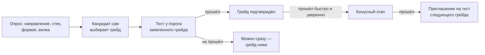

# Механика тестирования

Категорию «профессия × грейд» кандидат получает только по тесту. Тест должен одновременно:

1. **Не утекать** — единый набор заданий быстро расходится по рынку.
2. **Быть сопоставимым** — у кандидатов разные задания, а результат должен значить одно и то же.
3. **Различать грейды** — давать стабильное решение «подтверждён / нет» за разумное число заданий.

Решение в одной фразе: **у каждого кандидата свои варианты заданий, сгенерированные кодом с вычислимым ответом, а сопоставимость обеспечивает общая шкала сложности, измеренная на людях** (модель Rasch), и классификационный тест SPRT у порога заявленного грейда.

Код — `services/core/app/assessment/`, параметры — `data/scoring.yaml`, раздел `assessment`.

## 1. Путь кандидата



- Опрос: IT-направление (это и есть профессия), стек, форматы, вилка, заявленный грейд. Без резюме опрос пустой; с резюме — предзаполнен, но грейд всё равно выбирает кандидат.
- Грейды теста: Junior, Middle, Senior.
- Попытка начинается `POST /assessment/attempts {profession, declared_grade, mode}`.

## 2. Что проверяем: навыки шести типов

Профессия — взвешенный набор навыков (`data/taxonomy/roles.yaml`), каждый навык имеет тип:

| Тип | Смысл | Примеры |
|---|---|---|
| `fundamental` | Фундамент | алгоритмы, структуры данных |
| `hard` | Технологии | Python, SQL, React, RAG |
| `thinking` | Инженерное мышление | оценка нагрузки, поиск причины, граничные случаи |
| `business` | Бизнес | юнит-экономика, воронка, когорты |
| `soft` | Софт | ревью кода, конфликт, наставничество |
| `experience` | Опыт | порядок действий при инциденте, вклад в open source |

**План теста** — доли типов по грейду (у старших больше мышления и бизнеса), внутри типа — пропорционально весам навыков профессии:

| Грейд | fundamental | hard | thinking | business | soft | experience |
|---|---|---|---|---|---|---|
| Junior | 0.35 | 0.40 | 0.10 | 0.05 | 0.05 | 0.05 |
| Middle | 0.25 | 0.35 | 0.20 | 0.10 | 0.05 | 0.05 |
| Senior | 0.20 | 0.25 | 0.30 | 0.15 | 0.05 | 0.05 |

Навыки без заданий в банке выпадают из плана, их доли перераспределяются.

## 3. Задание = семейство, вариант = сид

**Семейство** — код: генератор варианта + решатель (ключ) + «ручки» сложности с границами. Вариант задаётся парой `(семейство, seed)`, где `seed = hash(candidate_id, attempt_id, family_id)`. Ключ никогда не уходит на клиент: в БД лежат только `(family_id, seed)`, задание пересобирается на сервере при выдаче и при проверке.

Правильный ответ берётся только из трёх источников:

- **вычисление** — исполнение кода, формулы, модели мира;
- **порча эталона** — в корректный код или схему вносится дефект из каталога («найди ошибку»);
- **таблица стратегий** — для софта и бизнес-ситуаций, с эмпирическим ключом.

LLM ключ не определяет никогда.

**Типы ответа** и их оценка (балл 0..1):

| `kind` | Ответ | Балл |
|---|---|---|
| `exact` | число или строка | 1 при совпадении после нормализации |
| `estimate` | число | 1 — ошибка в пределах ×2 (|log₁₀| ≤ 0.3); 0.5 — в пределах ×4; иначе 0 |
| `choice` | индекс варианта | 1 / 0 |
| `find_bug` | номера строк | 1 — все строки дефекта; 0.5 — половина; лишняя строка гасит найденную |
| `order`, `sjt` | перестановка | `1 − D/D_max`, D — сумма сдвигов позиций |
| `chain` | ответы по шагам инцидента | средний балл шагов |
| `open` | текст | только регулярные задания, в θ не идёт |

**Банк** (`families`) пополняется из нескольких источников:

| Источник | Как появляется |
|---|---|
| `code` | 37 процедурных семейств в `families/*.py`: трассировка кода, асимптотика, оценка RPS, SQL JOIN, агрегаты таблиц, аномалии KPI, корень инцидента в графе сервисов, порядок запуска сервисов, радиус поражения, цепочки-инциденты, RAG и LLM-бюджеты, SJT |
| `spec` | Конструктор: эксперт или работодатель задаёт параметры, шаблон условия и выражение ответа (безопасный вычислитель, код не исполняется) |
| `llm` | Офлайн-генерация: LLM предлагает форму конструктора, дальше та же автопроверка и допуск человеком |
| `mutation` | Майнинг мутаций открытого кода: функции проектов читаются как данные (AST), мутанты проверяются в песочнице-интерпретаторе |
| `fsp` | Задачи прошлых соревнований ФСП с лицензией и происхождением |

`make families-check` прогоняет каждое кодовое семейство на 1000 сидов: ключ вычисляется, ручки в границах, вариант детерминирован, у каждой профессии нет пустых ячеек «тип × грейд».

## 4. «Мир» варианта

`World.from_seed(seed, domain)` детерминированно строит вымышленную компанию: домен (e-commerce, финтех, онлайн-образование, RAG-сервис), название, сущности, граф сервисов с зависимостями и владельцами, связанные таблицы с данными, метрики с рядом за 14 дней, команду. Семейства берут из мира имена, числа и артефакты — поэтому одно и то же семейство у двух кандидатов выглядит как два разных задания про разные компании, а сложность (ручки) при этом одинаковая.

Домен выбирается по профессии (AI Engineer → RAG-сервис) или случайно. Экран администратора «Два мира» показывает одно семейство в двух доменах.

## 5. Сопоставимость: общая шкала Rasch

- Вероятность верного ответа: `P(θ, b) = 1 / (1 + e^−(θ − b))`, θ — уровень кандидата, b — сложность семейства. Частичный балл входит в правдоподобие дробным исходом.
- **θ** — апостериорное среднее (EAP) на сетке [−4, 4] с шагом 0.1 и априорным N(0, 1); **SE** — его СКО. θ считается и по каждому типу навыков отдельно.
- **Пороги грейдов** на шкале θ: Junior −1.0, Middle 0.0, Senior 1.0.
- **Начальная сложность** — по уровню семейства 1..5: b = −2, −1, 0, 1, 2.
- **Калибровка** после каждой попытки по финальному θ: `b ← b + K·(P(θ, b) − y)`, `K = max(0.05, 0.5/√(1 + n))`. **Якорные** семейства (K = 0) держат шкалу от дрейфа.

Поскольку сложность принадлежит семейству и измеряется на ответах людей, «разные задания» не означают «разную сложность»: θ разных кандидатов сравним.

## 6. Выбор следующего задания

1. **Секция** — навык плана с наибольшим дефицитом `доля·(k+1) − выдано`.
2. **Фильтры банка**: статус `active`; уровень в пределах грейда ±1; семейство не показывалось этому кандидату 90 дней; экспозиция за 7 дней < 30 % тестов (проверяется, когда тестов ≥ 20); участнику соревнования ФСП его задачи не выдаются.
3. **Счёт** `P(1−P)·(1 − 0.3·ai_solvable)` у порога грейда — максимум информации, с поправкой на решаемость задания нейросетью.
4. Выбор **равновероятно из топ-3** — снижает экспозицию лучших заданий.

**Пилотные слоты:** 2 скрытые позиции после 3-го задания; туда идут семейства `pilot` с наименьшим числом ответов. На θ и решение они не влияют — только собирают статистику для допуска.

## 7. Остановка: SPRT у порога

Тест не меряет θ «как можно точнее», а решает классификационную задачу: θ выше или ниже порога заявленного грейда.

- Гипотезы: θ₀ = cut − 0.7 и θ₁ = cut + 0.7.
- После каждого ответа: `LLR += y·ln(P₁/P₀) + (1 − y)·ln((1 − P₁)/(1 − P₀))`.
- Границы при α = β = 0.1: LLR ≥ +2.197 — прошёл, LLR ≤ −2.197 — не прошёл.
- Минимум 10, максимум 24 оцениваемых задания. На максимуме или при исчерпании банка решение по θ относительно порога с меткой «низкая уверенность».

**Бонусный этап.** Прошёл за ≤ 10 заданий и θ ≥ порога следующего грейда → в той же попытке до 10 заданий с SPRT у следующего порога. Прошёл бонус — кандидат получает **приглашение на отдельный тест следующего грейда** на 30 дней, без кулдауна. Автоповышения нет: так рекомендовали организаторы ([ADR-0012](../adr/0012-bonus-invites-not-promotes.md)).

**Экспресс-режим** для жюри: 6–8 заданий, α = β = 0.15, без бонуса и пилотов, 3–5 минут. Грейд помечается «экспресс»; обычный тест заменяет его без кулдауна, сам экспресс обычный грейд не перекрывает ([ADR-0013](../adr/0013-express-mode.md)).

Параметры подобраны на синтетике — [ADR-0008](../adr/0008-assessment-rasch-sprt.md), [validation.md](../quality/validation.md).

## 8. Правила грейда

| Правило | Значение |
|---|---|
| Грейд не понижается | Провал не меняет действующий грейд; записывается только прохождение на грейд не ниже текущего |
| Смена грейда | Не чаще раза в 90 дней |
| Повтор того же грейда после провала | Через 30 дней |
| Грейд ниже после провала | Сразу, одна попытка |
| Тест по приглашению бонусного этапа | Без кулдаунов; провал не закрывает повтор |
| Срок действия грейда | 365 дней |

Нарушение — `409 cooldown` с датой следующей попытки.

**Итог попытки** (`grading.on_finished`):

- запись в `grades`: грейд, θ, SE, положение внутри полосы грейда `T = clamp((θ − cut_g)/(cut_{g+1} − cut_g), 0, 1)`, θ по типам, честность, метки;
- доказательства `test` в граф навыков: сила по навыку = 0.75 × доля набранного, при низкой честности — не выше 0.59 (доверие ●●○○);
- события `assessment.attempt.finished` и, если набор категорий изменился, `candidate.category.changed`.

Кандидат видит результат, разбивку по типам навыков, разбор по навыкам, а работодатель — категорию, положение в полосе грейда и подтверждённые навыки.

## 9. Антисписывание: индекс честности

Без камер и прокторинга. Индекс `I` начинается с 1 и снижается за сигналы:

| Сигнал | Штраф |
|---|---|
| Верный ответ на нелёгкое задание (θ − b < 0.5) быстрее 0.3 медианы времени семейства | −0.15 за каждый |
| Уход со вкладки > 10 с, затем верный ответ | −0.15 за каждый, не больше −0.45 |
| Person-fit lz < −2 («решил сложное, ошибся на лёгком») | −0.2 |
| ≥ 2 «невозможных» неверных ответа, совпавших с верным ответом другого кандидата на его вариант | −0.3 |

`I < 0.6` → «требует подтверждения»: грейд записывается, но доверие к навыкам из теста ограничено, а сила профиля × 0.8. Санкций и банов нет.

Таймер задания — p95 времени ответа на семейство по последним 500 ответам (не меньше 15 с).

**«Объясни ответ»** после теста: причину ошибки определяют правила по заданию, ответу и времени (поспешил, ошибка вычисления, сдвиг на единицу, не тот порядок величины, найдена только часть дефекта, неверный порядок шагов, пробел в теме, типичное заблуждение из карточки навыка…). Кандидат может сам назвать причину и сравнить. LLM только формулирует текст, без LLM — шаблон; правильный ответ не раскрывается.

## 10. Почему это устойчиво к утечке

| Угроза | Защита |
|---|---|
| Ответы расходятся по рынку | Свой вариант у каждого: сид и «мир» делают тексты, числа и ключи разными; знание ответа одного варианта не даёт ответ другого |
| Утекло само семейство (идея задачи) | Экспозиция ≤ 30 % тестов, случайный выбор из топ-3, неповтор 90 дней; **тревога утечки** — рост среднего остатка `y − P(θ, b)` за последние 50 ответов на ≥ 0.2 → автоматический карантин |
| Списывание во время теста | Индекс честности, «невозможные» совпадения ответов между кандидатами |
| Нейросеть решает за кандидата | `ai_solvable` семейства снижает его выбор; LLM-«кандидат» на экспериментах получает метку «требует подтверждения» на Middle и Senior |
| Разная сложность разных заданий | Общая шкала Rasch, калибровка на людях, якоря |
| Олимпиадники знают задачи ФСП | Участнику соревнования его задачи не выдаются; DIF «с ФСП / без ФСП» обязателен для допуска ([ADR-0015](../adr/0015-fsp-tasks-without-advantage.md)) |

## 11. Жизненный цикл задания

```
draft ─ автопроверка ─► pilot ─ пороги + решение администратора ─► active ─ тревога ─► quarantine ─► retired
```

**Допуск `pilot → active`** — только кнопкой администратора и только при выполнении всех порогов: ≥ 30 ответов, точечно-бисериальная корреляция r_pb ≥ 0.2, |b| ≤ 3, разброс доли верных по группам сидов ≤ 0.15, DIF «с ФСП / без ФСП» ≤ 0.1 и утверждённый ключ.

**Тревоги** (переводят в карантин автоматически): r_pb < 0.05 при n ≥ 50, утечка, 3 апелляции. При выводе семейства из оценки θ затронутых попыток пересчитываются; грейд меняется, только если изменилось решение SPRT.

Карточка допуска показывает администратору профессии, грейд, пример варианта с ответом решателя и статистику пилота. Задания работодателя не попадают в общий банк автоматически: «Готово» открывает их только для своих приглашений и регулярных заданий.

## 12. Регулярные задания и задания работодателя

- **Конструктор** (`/employer/families/new`): шаблон, параметры, условие с подстановками из «мира», выражение ответа или таблица стратегий; ключ даёт автор или черновик LLM (утверждает человек); автопроверка на 200 сидах.
- **Регулярное задание**: компания выбирает категорию и период; кандидаты с действующим грейдом этой категории и согласием на публикацию получают задание. Каждый раунд — новый вариант. Оценка — автоматически или по рубрике работодателя (`open`). Результат видит компания-автор; в θ, грейд и силу профиля он не идёт.
- **Задание в приглашении**: работодатель прикрепляет задание к приглашению; результат видит только эта компания, а в профиль идёт доказательство `task` (сила не больше 0.5 × балл).

## 13. LLM в тесте

LLM **не участвует** в выдаче заданий, проверке ответов и расчёте грейда. Офлайн и только через ml-api она: предлагает черновики заданий (допуск — человек и пилот), даёт черновик ключа (утверждает администратор), отвечает на варианты как «кандидат» для оценки `ai_solvable`, формулирует текст «Объясни ответ». Без LLM всё работает: банк растёт генераторами, майнингом и конструктором.

## Где это в коде

| Файл | Что |
|---|---|
| `attempts.py` | Создание попытки, выдача, приём ответа, этапы |
| `selection.py`, `engine.py` | План, дефицит, счёт, фильтры банка, пилоты |
| `psychometrics.py`, `psychometrics_db.py` | Rasch, EAP, калибровка |
| `sprt.py` | LLR, решение, бонус |
| `grading.py` | Кулдауны, запись грейда, доказательства, события |
| `integrity.py`, `telemetry.py` | Индекс честности, таймер |
| `world.py`, `families/*` | «Мир» и кодовые семейства |
| `constructor.py`, `families/spec.py`, `expr.py` | Конструктор и безопасный вычислитель |
| `lifecycle.py`, `admission.py` | Статистика, допуск, тревоги, карточка допуска |
| `tasks.py`, `invite_bank.py` | Регулярные задания и задания в приглашении |
| `llm_bank.py`, `orders.py`, `mining/*`, `fsp_bank.py` | Источники банка |
| `explain.py` | «Объясни ответ» |
