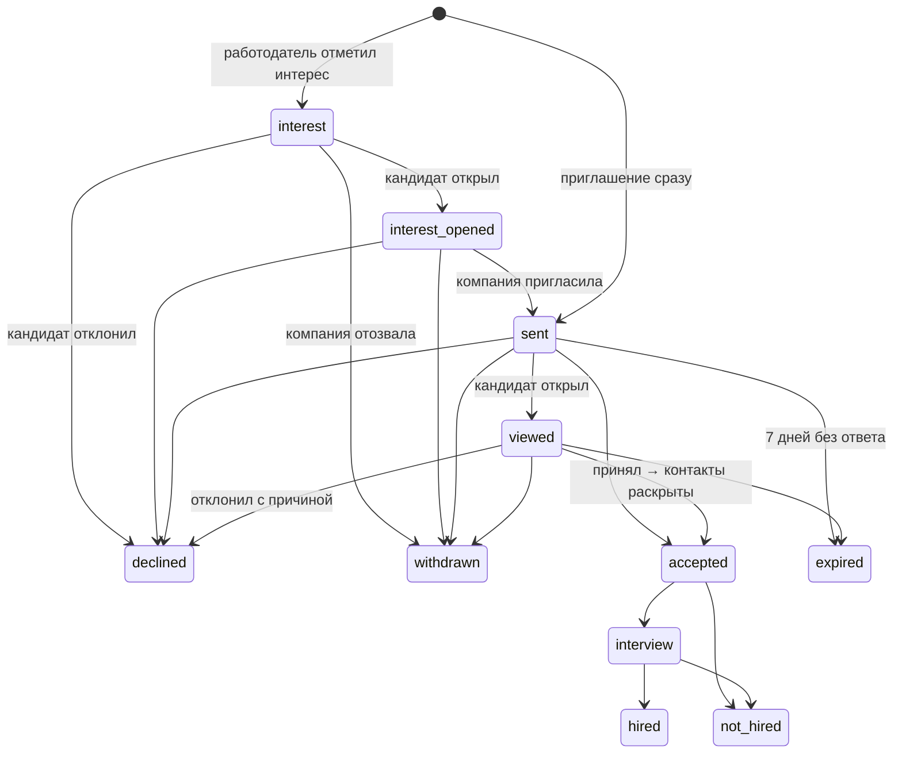

# Выход на контакт

Инициатива у работодателя: он находит кандидата в категории и сам предлагает условия. Кандидат видит компанию и вилку до начала общения, а его контакты открываются только после согласия.

Все сценарии — одна сущность `offers` с полем `initiator` и общим автоматом статусов ([ADR-0016](../adr/0016-offer-single-entity.md)). Код — `services/core/app/offers/`.

## Сценарии

### 1. Интерес (мягкий первый шаг)

Работодатель отмечает «интересен» с обязательной вилкой «от–до» и сообщением до 300 символов. Кандидат видит «K компаний интересуются вами», карточки компаний и вилки — без раскрытия себя. «Открыть» — компания получает уведомление и может пригласить; «Не интересно» — с причиной (вилка, формат, компания, не ищу). Срок интереса — 7 дней, лимит — 30 интересов компании за 7 дней.

### 2. Приглашение

Обязательно: вилка «от–до» в рублях (база «до НДФЛ» или «на руки»), название (если без вакансии), описание, способ связи; по желанию — вакансия, задание к приглашению. Перед отправкой работодатель видит вероятность принятия и подсказку по вилке ([matching.md](matching.md#7-помощь-работодателю-при-приглашении)).

Проверки:

- компания проверена администратором (`verified`);
- вакансия, если указана, опубликована;
- одно открытое приглашение без вакансии от компании одному кандидату; по вакансии — одно на пару;
- лимиты: компании — 20 приглашений за 24 ч, кандидату — не больше 10 входящих за 24 ч (`429` с `Retry-After`);
- `Idempotency-Key`: повтор того же запроса возвращает тот же оффер.

Кандидат видит компанию, отправителя (имя, должность), вилку, описание, «Почему вы» — факторы совпадения по его собственным данным — и надёжность компании. Ответ — «Принять» или «Отклонить» с причиной; приглашение истекает через 7 дней.

**Командное приглашение** — для команды ФСП, где на платформе видимы ≥ 2 участника: N обычных приглашений с общим `team_offer_id`, каждый участник отвечает сам.

### 3. Отклик кандидата

Кандидат откликается на опубликованную вакансию: вилка берётся из вакансии, контакты кандидата открываются компании **сразу** (отклик — его согласие), ход за компанией (`viewed`, `interview`, `hired`/`not_hired`), отозвать может кандидат. Лимит — 20 откликов в сутки; повтор на ту же вакансию — 409.

## Раскрытие контактов

- Единственная точка — переход в `accepted` (или создание отклика): в той же транзакции появляется запись `contact_reveals`.
- `GET /offers/{id}/contacts` до этого отвечает `409 contacts_not_revealed`.
- Кандидат может **отозвать доступ** — после этого компания контактов не видит.
- ФИО кандидата компания видит после своего приглашения (интерес без приглашения не считается) или раньше, если кандидат открыл ФИО в настройках.

## После принятия

- Переписка внутри приглашения (сайт и Telegram), 30 сообщений в час.
- Работодатель ведёт статусы найма: собеседование, нанят, не нанят. Обе стороны видят таймлайн переходов (`offer_events`).
- Задание к приглашению: кандидат решает до срока, результат видит только эта компания, в профиль идёт доказательство `task`.

## Уведомления

Каждый переход пишет событие `offer.*` (или `offer.interest.*`) в outbox. Обработчик создаёт уведомление, отправляет его в веб-интерфейс по SSE и, если привязан Telegram и есть согласие, — в бот с кнопками «Принять / Отклонить / Вопрос». До принятия в уведомлениях для работодателя нет ПДн кандидата.

## Защита от злоупотреблений

- Модерация компании и метка «проверена» для кандидатов.
- Обязательная вилка, предупреждение о вилке ниже ожиданий кандидата.
- Жалоба кандидата на приглашение (спам, дискриминация, фиктивная компания, несоответствие зарплаты, оскорбления) — разбирает администратор.
- Стоп-лист компаний у кандидата.
- Рейтинг ответственности компании (пересчёт раз в час): доля принятых приглашений минус 0.2 за каждое отозванное и 0.1 за каждое просроченное; используется в «надёжности» и `p_accept`.
