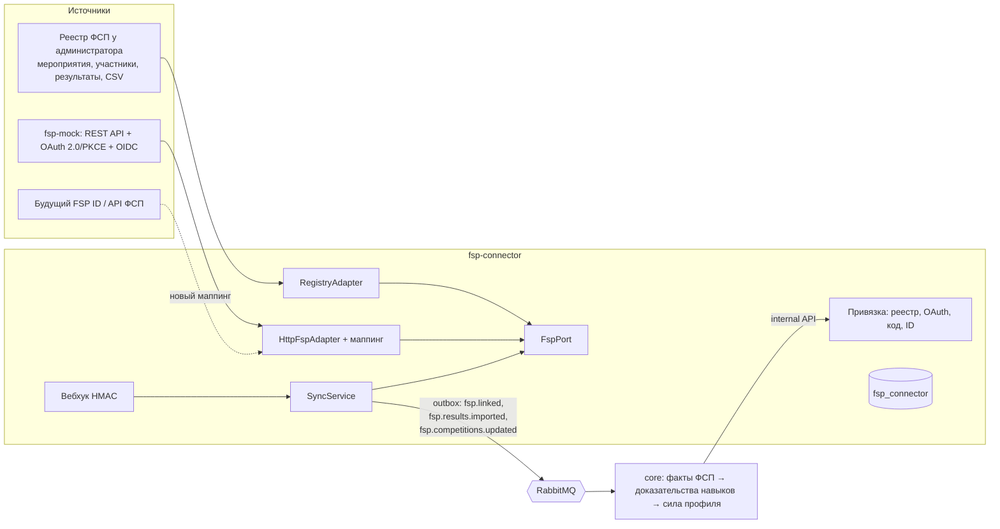

# Интеграция с ФСП

API и структуру данных ФСП организаторы не предоставили намеренно, FSP ID (на базе Keycloak) ещё молодой. Поэтому интеграция построена так, чтобы ядро не зависело от источника: вся работа с ФСП — в отдельном сервисе `fsp-connector` за портом `FspPort`, ядро получает только нормализованные события.

## Схема



## Данные

Нормализованные DTO (`packages/contracts/.../fsp.py`):

| Сущность | Поля |
|---|---|
| Участник | id, ФИО, год рождения, регион, маскированные контакты, разряды |
| Соревнование | id, название, дисциплина, уровень (региональное → международное), формат, регион, даты, статус, треки |
| Результат | соревнование, дисциплина, этап (отбор/финал), команда и роль (капитан/участник), место из N, балл, трек, дата |
| Разряд | дисциплина, разряд (юношеские, I–III, КМС, МС, МСМК) |
| Команда | состав с ролями |

Дисциплины: алгоритмическое, продуктовое, информационная безопасность, БПЛА, робототехника и др. Правила «дисциплина (и трек) → навыки с весами» — `data/fsp/discipline_rules.yaml`.

## Привязка профиля

**Основной путь — реестр** ([ADR-0019](../adr/0019-fsp-registry.md)):

1. Администратор ФСП ведёт реестр: мероприятия, участники (ФИО, email, телефон), результаты — вручную, списком или CSV.
2. Кандидат нажимает «Привязать ФСП» — core передаёт email аккаунта и телефон из контактов.
3. Поиск по нормализованным контактам (email в нижнем регистре, телефон в E.164): ровно одно совпадение → привязка сразу (`method = registry`, проверена).
4. Ноль или несколько совпадений → кандидат подаёт заявку (ФИО, контакты в ФСП, мероприятие), администратор принимает с выбором участника или отклоняет с причиной.

Один участник привязывается к одному аккаунту; попытка второй привязки пишется в `fsp_link_conflicts`.

**Готово к FSP ID:** в `fsp-connector` есть привязка через OAuth 2.0 Authorization Code + PKCE (S256) и по одноразовому коду на контакт участника (6 цифр, 5 попыток, 10 минут). Мок ФСП реализует `/oauth/authorize`, `/oauth/token`, `/oauth/userinfo`, `/oauth/jwks` и `/.well-known/openid-configuration` — тот же протокол, что у Keycloak. Подключение настоящего FSP ID — смена адреса и ключей клиента, без изменения ядра.

## Синхронизация

- Команда `fsp.sync {candidate_id}` — по кнопке кандидата, после привязки и по вебхуку; `fsp.sync_all` — раз в час для всех привязок плюс календарь соревнований.
- Вебхук `POST /integrations/fsp/webhook`: подпись `X-Signature: sha256=HMAC(secret, body)`, идемпотентность по `event_id`.
- HTTP-адаптер: экспоненциальные повторы, автомат размыкания (5 сбоев → пауза 30 с), кеш участника и результатов на 10 минут.
- Реестр — тоже источник через порт: изменение результата в реестре сразу отправляет полную выгрузку привязанному кандидату.

## Что происходит в core

1. Факты из событий сохраняются в таблицы `fsp_*` (порядок доставки не важен: доказательства пересобираются из сохранённого).
2. Каждый результат по правилам дисциплины превращается в доказательства `fsp` для навыков с силой `min(0.95, w × k_уровня × k_результата × k_этапа)` ([skills.md](skills.md#доказательства)).
3. Пересчёт доверия к навыкам, командных сигналов и силы профиля; уведомление кандидату о новом результате.
4. Соревнования ФСП в ближайшие 120 дней по нужным навыкам попадают в навигатор кандидата.

## Сила ФСП в выдаче

Слагаемое **F** силы профиля (вес 0.2) учитывает **результативность и число соревнований**, а не уровень: организаторы просили не ранжировать соревнования.

| Результат | Вес |
|---|---|
| Победитель | 1.0 |
| Призёр (2–3 место) | 0.85 |
| Финалист или топ-25 % | 0.55 |
| Участник | 0.25 |
| Без результата | 0.05 |

```
F = min(0.95, Σ_i v_i · 0.5^i)          v_i — по убыванию
v = вес результата × давность × релевантность × (0.5, если привязка не проверена)
давность     = 0.6 + 0.4 · 0.5^(лет/3)
релевантность = 0.4 + 0.6 · rel,   rel — доля веса навыков дисциплины, входящих в профессию
```

Лучший результат входит полностью, каждый следующий — с убывающей отдачей, поэтому набить профиль онлайн-явками нельзя. Дисциплина, нерелевантная профессии (робототехника для фронтендера), весит меньше, но не ноль. В карточке результат помечен «релевантно профессии» или «соревнование другого направления».

## Кандидат без ФСП

Обрабатывается штатно: F = 0 без штрафа, остальные слагаемые силы и весь путь (тест, категория, выдача, приглашения) работают так же. В профиле — кнопка «Привязать ФСП», в навигаторе — ближайшие соревнования.

## ФСП в тесте

Задачи прошлых соревнований ФСП могут входить в банк заданий, но участник соревнования их не получает, участие в ФСП не даёт бонуса к θ, а шкалу сложности таких задач задают кандидаты без ФСП ([ADR-0015](../adr/0015-fsp-tasks-without-advantage.md)).

## Мок ФСП

`fsp-mock` — имитация API ФСП в памяти с вымышленными данными: `/api/v1/participants`, `/participants/{id}/results`, `/competitions`, `/competitions/{id}/standings`, `/teams/{id}`, `/verification/send|check`, OAuth/OIDC, демо-ручки `/mock/results` (новый результат с вебхуком) и `/mock/reset`. Начальные данные пишет `make seed` (≈ 600 участников, 45 прошедших и 7 будущих соревнований).
