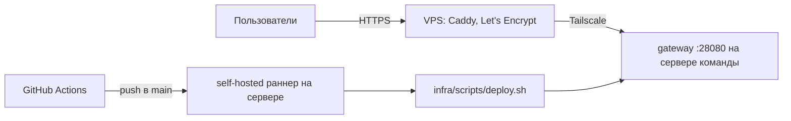

# Инфраструктура

Всё запускается одним `docker-compose.yml` с профилями. Сборка Python-сервисов — общий `infra/docker/python.Dockerfile` (uv, пакет и каталог сервиса — аргументы), фронта — `apps/web/Dockerfile` (сборка Vite, статику отдаёт Caddy).

## Сервисы compose

| Сервис | Профиль | Образ | Назначение |
|---|---|---|---|
| `gateway` | core | caddy:2 | Единая точка входа `:28080` |
| `web` | core | сборка `apps/web` | Статика SPA |
| `core-migrate` | core | fsp-core | Разово: `alembic upgrade head` + загрузка справочника навыков |
| `core-api`, `core-worker`, `core-scheduler` | core | fsp-core | API, обработчики очередей, расписание |
| `fsp-connector-migrate`, `fsp-connector`, `fsp-connector-worker` | core | fsp-fsp-connector | Интеграция с ФСП |
| `fsp-mock` | core | fsp-fsp-mock | Имитация ФСП |
| `postgres` | core | pgvector/pgvector:pg16 | Базы `core` и `fsp_connector` |
| `redis` | core | redis | Кеш и лимиты (1 ГБ, `allkeys-lru`, без сохранения на диск) |
| `rabbitmq`, `rabbitmq-init` | core | rabbitmq | Шина; init создаёт vhost `fsp` и пользователей сервисов |
| `minio`, `minio-init` | core | minio | Файлы; init создаёт бакет |
| `ml-api`, `ml-worker-llm`, `ml-worker-code` | ml | fsp-ml | ML-сервис |
| `bot` | bot | fsp-bot | Telegram-бот (включается при `TG_BOT_TOKEN`) |
| `dozzle` | dev | dozzle | Просмотр логов `127.0.0.1:28888` |
| `mailpit` | dev | mailpit | Ловушка писем с кодами `127.0.0.1:28025` |

Тома: `pgdata`, `rabbitdata`, `minio`, `hfcache` (кеш модели эмбеддингов). Порядок старта задан `depends_on` с проверками здоровья: приложение стартует после БД, брокера, бакета и миграций.

## Маршрутизация (gateway)

| Путь | Куда |
|---|---|
| `/api/v1/*` | core-api (префикс срезается; SSE без буферизации, таймаут 600 с) |
| `/api/docs`, `/api/redoc` | Swagger UI и ReDoc core-api |
| `/integrations/fsp/*` | fsp-connector (вебхук ФСП) |
| `/oauth/*` | fsp-mock (страница входа мока на том же адресе) |
| `/internal/*` | закрыт: 404 |
| остальное | web (SPA) |

На продовом стенде gateway дополнительно роутит по Host: `fsp.patissons.tech` — лендинг, `dashboard.` — кабинет, `api.`, `mock.`, `s3.` — соответствующие сервисы.

## Порты на хосте

Только диапазон 28xxx: gateway `28080`, PostgreSQL `127.0.0.1:28432`, RabbitMQ UI `28672` (только локально), dozzle `28888`, mailpit `28025`, фронт в режиме разработки `28173`, playground `@fsp/ui` `28174`, временные контейнеры интеграционных тестов — `285xx`.

## Безопасность контура

- Секреты только в `.env` (не в git); `make up` без `.env` генерирует `.env.demo` со случайными значениями.
- У каждого сервиса свой пользователь PostgreSQL (база только своя) и RabbitMQ.
- Internal API закрыт на gateway и требует сервисного токена.
- TLS терминируется на внешнем Caddy (VPS), внутри контура — HTTP.

## Продовый стенд

- **VPS** принимает трафик доменов `*.fsp.patissons.tech`, выпускает сертификаты и проксирует на сервер команды через Tailscale ([infra/vps/README.md](../../infra/vps/README.md)).
- **CI** (`.github/workflows/ci.yml`, на каждый PR): ruff, import-linter, проверка ссылок документации, сверка `docs/openapi.json` с кодом, pytest; PDF-смоук в образе core; `families-check` и `cards-check`; lint, typecheck, тесты и сборка фронта.
- **CD** (`.github/workflows/cd.yml`, push в `main`): CI → self-hosted раннер с меткой `fsp-stand` → `deploy.sh`: перевод каталога стенда на коммит, бэкап, сборка и запуск, проверка здоровья API, SPA и справочника, смоук ML и бота; при сбое — откат на прежний коммит. Ручные действия: `backup`, `demo-reset`, `demo-reseed`, `demo-e2e` (Playwright против прода), `prod-init` (пересоздание стенда с подтверждением).
- **Окружение прода** собирается `render-env.sh` из `infra/env/prod.env` (несекретное), `.env.server` на сервере и секретов окружения GitHub `prod`.
- **Бэкапы** (`backup.sh`): `pg_dump` баз `core` и `fsp_connector`, архив тома MinIO, проверка дампов `pg_restore --list`, хранение `BACKUP_KEEP_DAYS`; ночью по таймеру и перед каждым деплоем. Восстановление — `restore.sh`.
- **Мониторинг**: внешний бот следит за контейнерами и HTTP-адресами стенда и присылает тревоги команде.

## Ресурсы

Профиль `lite`: сервисы приложения ≈ 1.5 ГБ RAM, плюс PostgreSQL, Redis (до 1 ГБ), RabbitMQ и MinIO. GPU не требуется. Локальная LLM (`llama-server` с моделью 4B) — только на стенде команды, вне compose.
