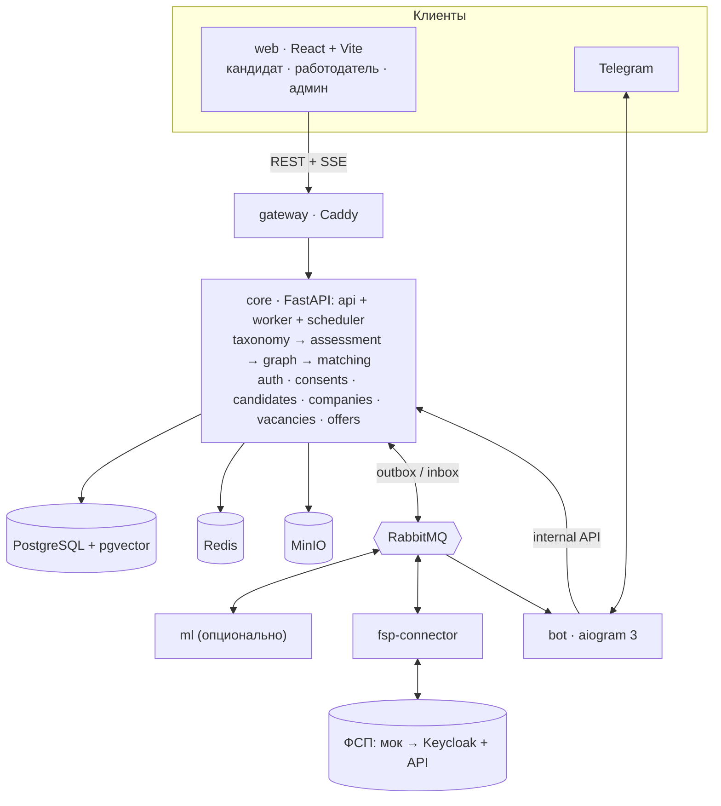

# ФСП Карьера: документ сдачи

> Источник для PDF и DOCX (`make submission-pdf` → `reports/submission/submission.pdf` и `submission.docx`). Структура повторяет «Документация должна включать» из ТЗ ([case.md](case.md)). Подробности — в ссылках на документы репозитория. Цифры §5 — из прогона `make metrics` 2026-10-07 (синтетика), отчёт — [reports/metrics-2026-10-07.md](reports/metrics-2026-10-07.md); цели — [metrics.md §9.1](architecture/metrics.md#91-сразу-после-кода-без-пользователей).

## Соответствие ТЗ

Пункты «Документация должна включать» из [case.md](case.md) и разделы этого документа. Таблицу проверяет `tools/submission/check_tz.py`.

| Пункт ТЗ | Где в документе |
|---|---|
| функциональную и компонентную архитектуру | §2 |
| механику тестирования с обоснованием устойчивости к утечкам | §3 |
| механику подбора и категоризации | §4 |
| процедуру валидации и её результаты | §5 (ограничения — §10) |
| схему интеграции с реестром ФСП | §6 |
| описание API | §7 |
| библиотеки с версиями | §8 |
| пошаговую инструкцию сборки и запуска | §9 |

## 1. Решение в двух абзацах

**ФСП Карьера** — веб-платформа подбора ИТ-специалистов с обратной механикой: работодатель сам находит нужную категорию и выходит на конкретного кандидата с приглашением, описанием и обязательной зарплатной вилкой «от–до». Категория кандидата (профессия × грейд) определяется **тестом**, а не резюме. Результаты ФСП двигают кандидата внутри категории вверх, но не задают грейд; кандидат без истории ФСП работает полностью, без штрафа.

Тест устойчив к утечкам: задание — это экземпляр **семейства** (генератор, решатель, ручки сложности), вариант строится из `seed = hash(кандидат, попытка, семейство)`, у каждого кандидата свой «мир». Уровень считается моделью Rasch на общей шкале θ, остановка — классификационный SPRT у порога грейда. Подбор детерминирован: сила профиля и ранг считаются формулами, LLM только извлекает данные и формулирует текст.

## 2. Функциональная и компонентная архитектура

Модульный монолит на FastAPI плюс спутники: ML, коннектор ФСП и Telegram-бот. Подробно — [system.md](architecture/system.md), [services.md](architecture/services.md).

| Компонент | Назначение |
|---|---|
| web | React + Vite + TypeScript: кабинеты кандидата, работодателя и админа ФСП |
| gateway | Caddy: единственная точка входа (порт 28080), маршруты, SSE |
| core | FastAPI: api, worker (FastStream), scheduler. Модули: taxonomy, assessment, graph, matching, offers, auth, consents, candidates, companies, vacancies |
| ml | Разбор резюме, эмбеддинги, LLM-черновики; опционален (`LLM_ENABLED=false` → правила и NER) |
| fsp-connector | Порт ФСП, привязка ID, синхронизация, своя БД |
| fsp-mock | Имитация API и OIDC ФСП (ФСП данные намеренно не даёт) |
| bot | aiogram 3: приглашения в Telegram, без бизнес-логики |
| PostgreSQL + pgvector, RabbitMQ, Redis, MinIO | Данные, события (outbox/inbox), кеш и лимиты, файлы |

Принципы: границы сервисов (ml, fsp-connector и bot не ходят в БД core; модули core общаются через `service.py`, это проверяет import-linter); outbox в одной транзакции с данными и идемпотентные обработчики (inbox); безопасность и 152-ФЗ — отдельные согласия, контакты закрыты до принятия приглашения или отклика, остальное в карточке — по настройкам кандидата (ADR-027), пароли argon2, код кандидатов не исполняется ([security.md](architecture/security.md)).

**Функциональные блоки.** Кандидат: регистрация по email, профиль вручную или из PDF резюме, опрос, выбор грейда, тест, категория, история и пересдачи, приглашения (принять или отклонить), согласия, привязка ID ФСП. Работодатель: профиль компании, потребность → подборка категорий и кандидатов с объяснением, поиск с фильтрами, приглашение с вилкой, вакансии и отклики. Админ: банк заданий, допуск, карантин, модерация.

## 3. Механика тестирования и устойчивость к утечкам

Подробно — [assessment.md](architecture/assessment.md), [solution.md §3, §5](solution.md).

| Элемент | Как устроено |
|---|---|
| Задание | Экземпляр семейства; вариант строится из `seed = hash(кандидат, попытка, семейство)` |
| Мир | Контекст варианта: вымышленная компания (домен, сервисы, таблицы, метрики); домен берётся из вакансии |
| Правильный ответ | Три источника: вычисление, порча эталона с формальной проверкой, таблица стратегий. Ключ от LLM — только черновик |
| Уровень | Rasch, общая шкала θ, оценка EAP; отдельно θ по типам навыков |
| Остановка | SPRT у порога заявленного грейда: δ = 0.7, α = β = 0.1, 10–24 задания (ADR-030) |
| Выбор задания | Секция плана с наибольшим дефицитом, затем `P·(1−P)·(1−0.3·ai_solvable)`, случайный из топ-3, ограничение экспозиции |
| Грейд | Принудительно не понижается; смена не чаще раза в 90 дней, повтор через 30, результат действует 12 месяцев; повышение — отдельным приглашённым тестом, без автопрыжка (ADR-025) |
| Экспресс | Для жюри: 6–8 заданий, 3–5 минут, метка «экспресс» (ADR-025) |

**Почему устойчив к утечкам.**

- Единого набора заданий нет: у каждого свои варианты и свой мир, ответы не уходят на клиент.
- Сложность откалибрована на общей шкале, поэтому разные наборы сопоставимы (в отличие от генерации нейросетью под каждого).
- Задание попадает в банк через `draft → автопроверки → pilot → решение админа → active`; LLM не определяет ни грейд, ни сложность и во время теста не используется.
- Автокарантин семейства при отрицательной дискриминации, апелляциях и признаках утечки (тревога по доле верных ответов).
- Индекс честности (время ответа, person-fit, уходы со вкладки, вставки, совпадения): ниже 0.6 — метка «требует подтверждения» и потолок доверия. Без банов, камер и анализа лица или голоса.

## 4. Механика подбора и категоризации

Подробно — [matching.md](architecture/matching.md), [assessment.md §9](architecture/assessment.md#9-ранжирование-кандидатов).

- **Категория** = профессия × грейд, подтверждённый тестом. Профессии MVP: Backend и Frontend полностью и витрина AI Engineer, грейды Junior / Middle / Senior (ADR-027, уточняет ADR-025); остальные профессии остаются в справочнике, в опросе скрыты (E36-2).
- **Заявленный, но не подтверждённый грейд** не скрывается: метка «не подтверждён», сила × 0.5, фильтр «только подтверждённые» включён по умолчанию.
- **Сила профиля** = (0.5·тест + 0.2·ФСП + 0.15·подтверждённые навыки + 0.1·свежесть + 0.05·полнота) × 0.8, если стоит метка «требует подтверждения».
- **ФСП** считается по результативности (победитель, призёр, финалист, участник) и числу соревнований с убывающей отдачей; уровни и дисциплины не ранжируем. Без ФСП слагаемое равно нулю без штрафа.
- **Ранг в выдаче** = 0.6·соответствие потребности + 0.4·сила профиля; объяснение — три слагаемых с наибольшим вкладом плюс «заявлено vs подтверждено».
- **Выход на контакт.** Работодатель описывает потребность, получает рекомендованные категории и кандидатов, шлёт приглашение (описание, вилка, компания, способ связи). Статусы видят обе стороны; контакты кандидата открываются после принятия или собственного отклика.

## 5. Процедура валидации и её результаты

> **Все цифры ниже — синтетика**, не живые пользователи. Прогон 2026-10-07, коммит `b2ecad7`. Полный отчёт без ПДн: [reports/metrics-2026-10-07.md](reports/metrics-2026-10-07.md).
>
> **Воспроизвести:** `make metrics SEED=42` (без make: `uv run python -m tools.metrics --seed 42 --out reports/metrics`), около 2,5 минут, без GPU и стенда.

Процедура ([evaluation.md](architecture/evaluation.md), [metrics.md §9](architecture/metrics.md)):

- **Тест** — `make eval-assessment` (seed 42, параметры — ADR-030): 1000 синтетических кандидатов с известным θ и профессией, задания по откалиброванной модели, среди них «списывающие» и «знающие утёкшие варианты»; повторяемость — две попытки с разными вариантами.
- **Подбор** — `make eval` (`tools/eval/run.py`, в `make metrics` — сплит `test`): синтетический рынок, 1000 кандидатов (244 приукрашивают резюме), 109 потребностей с известной разметкой; база — BM25 по тексту резюме; вклад ФСП — абляция «наш подбор без ФСП».
- **Справедливость** — impact ratio «без ФСП / с ФСП» при равном T на пуле 3000 (`tools/metrics/core_probe.py`).
- Не измерено в этом прогоне (нужен стенд или GPU): нагрузка 50 пользователей, F1 резюме, объяснимость карточек, живые прогоны 15–25 человек.

**Подбор (критерий 35 %), синтетический рынок, сплит `test`:**

| Метод | precision@10 | nDCG@10 | Приукрашенных в топ-10 |
|---|---|---|---|
| BM25 по резюме (базовая линия) | 0.146 | 0.178 | 0.174 |
| BM25 + фильтры грейда и зарплаты | 0.305 | 0.392 | 0.230 |
| **Наш подбор** | **0.312** | **0.410** | **0.161** |
| Наш подбор без ФСП | 0.313 | 0.409 | 0.147 |
| Наш подбор без GitHub | 0.063 | 0.115 | 0.013 |

| Метрика | Результат | Цель | |
|---|---|---|---|
| Прирост nDCG@10 к BM25 | +130.1 % | ≥ +20 % | достигнуто |
| Прирост precision@10 к BM25 | +113.8 % | отчёт | |
| Прирост nDCG@10 к BM25 с фильтрами | +4.8 % | отчёт | |
| Вклад ФСП, Δ nDCG@10 (с ФСП − без ФСП) | +0.002 | отчёт | мал, см. ниже |
| Категории потребности: настоящая роль среди предложенных | 100 % | отчёт | |
| Справедливость: impact ratio «без ФСП / с ФСП» при равном T | 0.342 | 0.8–1.25 | **не достигнуто** |

**Тест (критерий 25 %), синтетика, seed 42** (metrics.md §9.1):

| Метрика | Результат | Цель | |
|---|---|---|---|
| Точность грейда вне зоны безразличия (\|θ − cut\| ≥ δ, δ = 0.7) | 0.942 | ≥ 90 % | достигнуто |
| Общая точность грейда | 0.740 | отчёт | см. ниже |
| Грейд ±1 | 0.989 | отчёт | |
| Повторяемость κ (две попытки, разные варианты) | 0.52 | ≥ 0.8 | **не достигнуто** |
| Длина теста; доля дошедших до максимума | 13.1; 9.7 % | ≤ 14; ≤ 10 % | достигнуто |
| r(θ̂, θ) на полной длине | 0.869 | ≥ 0.85 | достигнуто |
| Калибровка RMSE(b̂ − b) после 30 / 100 ответов | 0.37 / 0.31 | ≤ 0.4 / ≤ 0.25 | 30 — достигнуто; 100 — нет |
| Медиана `r_pb` (дискриминативность) | 0.41 | ≥ 0.3 | достигнуто |
| Ответов до карантина утёкшего семейства | 80 | ≤ 100 | достигнуто |
| Утечка: ложные повышения у «знающих» | 24.3 % (фон 13.5 %) | ≤ 5 % | **не достигнуто** |
| Максимальная экспозиция семейства | 0.26 | ≤ 0.3 | достигнуто |
| Детектор честности: TPR; FPR | 81 %; 0.3 % | отчёт; FPR ≤ 5 % | достигнуто |
| Экспресс-режим: длина; точность вне зоны безразличия; κ | 7.0; 69.6 %; 0.50 | отчёт | |
| LLM-«кандидат» (симулятор) заявил senior: получил senior; помечен индексом честности | 20 %; 100 % | отчёт | |

**Как читать.** Общая точность 0.74 и κ 0.52 ниже целей по конструкции: у порога грейда решение вероятностное, а для точности 0.9 и κ 0.8 модели Rasch нужно около 200 заданий у порога (ADR-030). Поэтому цель по точности задана вне зоны безразличия, а решения в зоне ±0.7 помечаются «низкая уверенность». Подбор обгоняет BM25 более чем вдвое; у BM25 с фильтрами грейда и зарплаты отрыв небольшой (+4.8 % nDCG), зато в топ-10 меньше приукрашенных резюме. Вклад ФСП в nDCG на синтетике почти нулевой (+0.002): разметка релевантности считается по настоящим уровням навыков (`tools/synth/synth.py`, `relevance`), а ФСП в синтетике (40 % кандидатов) — зашумлённый сигнал тех же навыков, который почти полностью дублируют тест и GitHub. Поэтому ценность ФСП в продукте — подъём внутри категории и доверие к профилю, а не рост nDCG на этой разметке. Impact ratio 0.34 означает, что кандидаты без ФСП при равном T реже попадают в верх по силе профиля, — веса `strength` в `scoring.yaml` нужно перенастроить, это открытая задача.

## 6. Схема интеграции с реестром ФСП

Подробно — [fsp.md](architecture/fsp.md). API и данные ФСП организаторы намеренно не дают, поэтому интеграция построена на порте.

- **Порт `FspPort`** в `fsp-connector` с нормализованными DTO (участник, результаты, соревнования, команды). Сейчас за портом — `fsp-mock` с предполагаемым API; для реального ФСП меняется только адаптер, core не меняется.
- **ФСП ID:** OIDC-совместимый вход (discovery, JWKS, PKCE, `id_token` RS256); мок совместим, переход на Keycloak — сменой настроек.
- **Привязка:** OAuth «Войти через ФСП»; код подтверждения на контакт из данных ФСП; ручной ID (не верифицирован, доказательства × 0.5). Один участник — один аккаунт.
- **Синхронизация:** команда `fsp.sync` → события `fsp.results.imported`, `fsp.competitions.updated` → факты ФСП в графе доказательств core. У коннектора своя БД.
- **Кандидат без истории ФСП** обрабатывается штатно: слагаемое ФСП равно нулю без штрафа.

## 7. Описание API

Источник правды — OpenAPI, который генерирует FastAPI: `/api/v1/openapi.json`, Swagger UI `/api/docs`, ReDoc `/api/redoc` (через gateway, порт 28080). Снимок спецификации лежит в [openapi.json](openapi.json), клиент фронта генерируется `make api-gen`. Описание договорённостей и каталог эндпоинтов — [api.md](architecture/api.md); эндпоинты теста — [assessment.md §10](architecture/assessment.md). Ошибки — Problem Details с машинным `code`; чужой ресурс возвращает 404.

## 8. Библиотеки с версиями

Полный список (Python и JavaScript, прямые и транзитивные зависимости, версии и лицензии) генерируется из `uv.lock` и `pnpm-lock.yaml`: [libraries.md](libraries.md), команда `make submission-libs`. Основной стек: Python 3.12, FastAPI, SQLAlchemy 2, FastStream + RabbitMQ, aiogram 3, Pydantic 2; React 19, Vite, TypeScript, TanStack Query, Tailwind; PostgreSQL 16 + pgvector, Redis 7, Caddy. Лицензии без метаданных помечены «проверить».

## 9. Пошаговая инструкция сборки и запуска

Подробно — [deployment.md](architecture/deployment.md). Нужны Docker с Compose, `make`, `uv` (для сидов и оценок).

1. `git clone <репозиторий> && cd lct-fsp`
2. `make up` — генерирует `.env.demo`, собирает образы, запускает миграции и все сервисы с проверкой здоровья. Вариант без LLM и с малой памятью (≈ 1.2–1.5 ГБ на сервисы приложения): `make up-lite`.
3. `make seed` — демо-данные (детерминированно, `SEED=42`); в конце печатаются логины демо-аккаунтов. Вернуть исходное состояние: `make demo-reset`.
4. Открыть `http://localhost:28080`. Демо-аккаунты: герои `anya@`, `dima@`, `olga@demo.fsp.test`, админ `admin@demo.fsp.test`; пароль — `demo.password` в `tools/seed/config.yaml`.
5. Путь по ТЗ: регистрация (или демо-аккаунт) → опрос → тест (для жюри есть экспресс-режим) → категория → вход работодателя (`hr01@demo.fsp.test` и далее) → поиск категории → приглашение → принятие кандидатом.
6. Проверки: `make test`, `make lint`, `make eval-assessment`, `make load`.
7. Автоматическая проверка пути по ТЗ на поднятом стенде с сидом: `make e2e` (весь набор) или `cd apps/web && pnpm e2e e2e/joint-demo.spec.ts` — регистрация → опрос и тест → категория → работодатель находит → приглашение → отклик, скриншоты 1440 и 375 px (спек `apps/web/e2e/joint-demo.spec.ts`).

**Стенд жюри** (ориентир 32–64 ГБ RAM, ~8 CPU, без GPU): обязательный путь от GPU и LLM не зависит; подходят профили `lite` и `standard` (ADR-025). Профиль `full` с GPU — только наш демо-стенд.

## 10. Ограничения и честные оговорки

Документ отражает состояние репозитория на момент сборки; перед сдачей сверить со статусами в [plan.md](process/plan.md).

- **Метрики синтетические.** Цифры раздела 5 получены на синтетике с известным θ, а не на реальных людях. Согласие теста с экспертом, живые прогоны 15–25 человек и SUS **не проведены** (E27-3); приведены только цифры из реального прогона `make metrics` (отчёт [reports/metrics-2026-10-07.md](reports/metrics-2026-10-07.md)). Не достигнуты цели по κ повторяемости, ложным повышениям при утечке и impact ratio «без ФСП / с ФСП». Нагрузка 50 пользователей, покрытие кода и объяснимость карточек в этом прогоне не измерены: нужен поднятый стенд.
- **Общая точность грейда 0.74** ниже целевых 90 %: цель выполнена только вне зоны безразличия (см. раздел 5).
- **Стенд.** Публичного стенда на момент сборки документа нет (ссылка в README помечена как «появится после первого деплоя»). Профили `lite` и `standard` на машине класса «жюри» (без GPU) как единый прогон с нуля **не проверены**; цифры памяти ориентировочные ([deployment.md](architecture/deployment.md)).
- **LLM.** Модель для CPU-профиля выбирается замером (E32-3, ADR-025 п. 8). Качество LLM-функций (разбор резюме, черновики) в цифрах не проверено. Основной путь (тест, подбор) от LLM не зависит; при `LLM_ENABLED=false` работают правиловые альтернативы, но их качество ниже (цель F1 резюме ≥ 0.6 вместо ≥ 0.8 с LLM).
- **ФСП.** Реального API ФСП нет; интеграция проверена на нашем моке, формат реального API может отличаться.
- **Вне MVP (концепции):** защита от фиктивных вакансий и интеграция с ATS описаны в [system.md §12.1](architecture/system.md#121-концепции-не-реализуем-в-хакатоне), не реализованы полностью.
- **E2E.** Спек `joint-demo.spec.ts` включён в список Playwright (10 тестов в 4 файлах), но на момент сборки на поднятом стенде в этой сессии не прогонялся (стек не запущен). Новый соискатель отвечает в тесте «Не знаю», поэтому шаги работодателя идут по сид-кандидатам.
- **Данные и лицензии.** Демо-данные синтетические, компании вымышленные. Часть ядра навыков получена из Stack Overflow (CC BY-SA 4.0). Лицензии библиотек со статусом «проверить» требуют ручной проверки.
